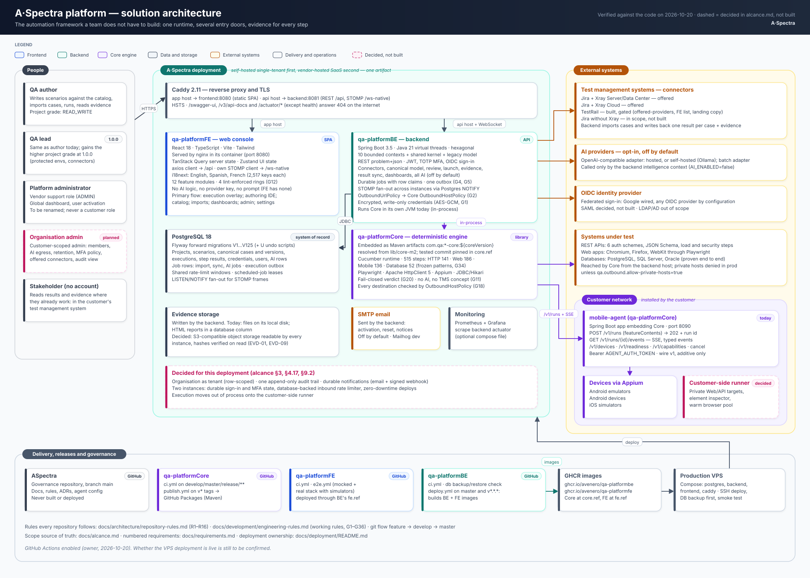

# Architecture diagrams

Status: Current-verified (code) for diagrams of today's state; Intended where a section says so | Owner: TBD

Code-grounded architecture of A·Spectra across `qa-platformCore`, `qa-platformBE` and `qa-platformFE`.
Diagrams of today's state trace every node to a real file. Diagrams of the target state are labelled
Intended and come only from [alcance.md](../alcance.md), the single source of truth for scope, with
requirement IDs from [requirements.md](../requirements.md). Renders in GitHub, GitLab, VS Code and
IntelliJ.

Shared facts not drawn here live in [platform.md](../architecture/platform.md) and
[engineering-rules.md](../development/engineering-rules.md); each repository's own rules are in its
`AGENTS.md` and `.claude/CLAUDE.md`.

## Architecture design diagrams

Four designed diagrams, verified against the code on 2026-10-20. Solid shapes are today's state; dashed
pink shapes are decided in [alcance.md](../alcance.md) and not built. Each repository folder explains its
diagram in its README.

| Diagram | Shows |
|---|---|
| [aspectra-platform.svg](aspectra-platform.svg) | The whole solution: people, the deployment (Caddy, FE, BE, embedded Core, PostgreSQL, evidence, email, monitoring), external systems, the customer network with the mobile agent, and delivery from GitHub to the VPS |
| [architectureBE/qa-platformBE.svg](architectureBE/qa-platformBE.svg) | Inbound adapters, the ten bounded contexts, outbound adapters, shared kernel, legacy layer, build guards and the five durable pipelines |
| [architectureCore/qa-platformCore.svg](architectureCore/qa-platformCore.svg) | Consumers, the `common` contract and runtime, the protocol plugins and mobile agent, the step catalog, guardrails and the build and release chain |
| [architectureFE/qa-platformFE.svg](architectureFE/qa-platformFE.svg) | The application shell, the twelve feature modules, the shared ring, data flow over REST and STOMP, lint boundaries, tests and delivery |

## How this is organized

| Folder | Scope |
|---|---|
| [architectureGeneral/](architectureGeneral/README.md) | The whole solution at macro level: the entry doors and target runtime, the 8-stage connector loop, critical example flows (Jira/Xray, Postman, Swagger/OpenAPI, user-story imports, an AI-assisted review path, a mobile run), and where the `intelligence` capability sits across repos |
| [architectureCore/](architectureCore/README.md) | `qa-platformCore` internals: modules, the plugin-host runtime, transports, the step catalog, and the guardrails that keep AI out |
| [architectureBE/](architectureBE/README.md) | `qa-platformBE` internals: bounded contexts, the overlay BC, the launch pipeline and durable-job patterns, result sync, the `intelligence` bounded context, cross-cutting concerns |
| [architectureFE/](architectureFE/README.md) | `qa-platformFE` internals: the four lint-enforced rings, the overlay feature, state/errors/i18n/tests, the `assistant` feature |

Start with `architectureGeneral/` for the product-level picture, then open the folder for the repository
you need to go deeper on.

## What changed on 2026-10-20

- New [architectureGeneral/00-entry-doors-and-runtime.md](architectureGeneral/00-entry-doors-and-runtime.md):
  the five entry doors, two stored models and three launch paths as they exist today, mapped against the
  decided scope, plus the target runtime with the customer-side runner.
- The connector loop is presented as one door among several, and review as a convention of the console
  flow (alcance §1.2, §1.3).
- Each repository folder gains a "Decided changes" table linking the architecture to requirement IDs.
- Corrected facts: TestRail is gated in the backend as well as the FE; the inbound rate limiter is per
  instance; the two step-audit couplings in BE are resolved; file, line, key and test counts refreshed.

## Earlier rewrite (2026-10-03)

This folder previously held five flat files (`01-general-architecture.md` through
`05-proposed-ai-architecture.md`). They have been replaced by the four folders above, each holding
several focused files instead of one dense page per repository. Two corrections drove the restructure,
both verified directly against the code by independent review of each repository:

- **The `intelligence` bounded context (BE) and the `assistant` feature (FE) are implemented, not
  proposed.** The former `05-proposed-ai-architecture.md` described a design as "PROPOSED, not
  implemented." It was not: 97 files under `qa-platformBE/.../intelligence/` and 34 files under
  `qa-platformFE/src/features/assistant/` implement it today, each with its own architecture test
  coverage (`BoundedContextRulesTest` on the BE side, declared `eslint.config.js` boundary rules on the
  FE side). It is governed and off by default (`AI_ENABLED=false`), which is a deployment posture, not
  an implementation gap. This content now lives as current architecture in `architectureBE/
  05-intelligence-bounded-context.md`, `architectureFE/04-assistant-feature.md`, and
  `architectureGeneral/03-intelligence-overview.md`.
- **A companion `architecture.md` was cited throughout the old files and does not exist anywhere in this
  workspace.** Every reference to it has been removed; citations now point to the real source (each
  repository's own `.claude/CLAUDE.md`) or to the code directly.

Several other stale facts, caught during the same review, are corrected in place rather than carried
forward silently — notably: TestRail's connector is fully built in both BE and FE and is withheld from
the 1.0 connector picker by a single FE allowlist, not missing; several Core step-audit findings from
2026-09-22 are resolved in current code; FE's overlay feature and i18n key count have grown
substantially since they were last measured; and the AI capability pipeline's real capability count is
11, not the 12 the old proposed doc listed.
