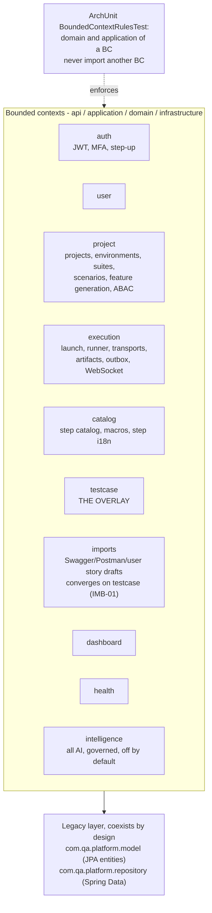

# Bounded contexts

Status: Current-verified (code, 2026-10-03; spot-checked 2026-10-20) | Owner: TBD

Cross-BC access goes through `infrastructure` ACL adapters only.

## The `intelligence` BC is enforced exactly like every other BC

`BoundedContextRulesTest` has a dedicated section ("Intelligence BC") with five ArchUnit rules:

- `intelligence.domain`/`.application` cannot import project/catalog/execution/imports/dashboard/testcase.
- `intelligence.domain` does not import `intelligence.infrastructure` (standard hexagonal rule).
- `intelligence.infrastructure` ACL adapters may only touch other BCs' **published ports**
  (`catalog.domain.stepcatalog..`, `project.application.port..`, `execution.application.port..`,
  `testcase.application.port..`, `execution.domain.model..`), never their internals.
- No other BC may import `intelligence.domain.port`, `.application.port`, `.application.check`, or
  `.infrastructure`.
- Only classes inside a consuming BC's own `..infrastructure.acl..` package may import anything in
  `com.qa.platform.intelligence..` at all.

## Who actually consumes `intelligence` today

Broader than a single BC — confirmed by a workspace-wide import grep:

- `testcase.infrastructure.acl`: `IntelligenceNormalizationAdapter` (implements `AiNormalizationPort`),
  `IntelligenceStepMappingAdapter`, `IntelligenceDuplicateDetectionAdapter`,
  `IntelligenceFieldMappingAdapter`, `IntelligenceReviewExplanationAdapter`, `IntelligenceProposalAdapter`.
- `catalog.infrastructure.acl`: `IntelligenceMacroAdapter` (`macro.draft` / `macro.name`).
- `execution.infrastructure.acl`: `IntelligenceFailureTriageAdapter`, `IntelligenceRunSummaryAdapter`.
- `imports.infrastructure.acl`: `IntelligenceSpecDraftAdapter`.
- `project.infrastructure.acl`: `IntelligenceEnvironmentHintAdapter`.

Each port is one per capability (`AiNormalizationPort`, `AiStepMappingPort`, `AiDuplicateDetectionPort`,
`AiFieldMappingPort`, `AiReviewExplanationPort`, `AiProposalPort`), not one shared `TestCaseAiPort`.

## Coupling issues from the 2026-09-22 step audit

Re-checked against the code on 2026-10-20:

- **Resolved:** `ScenarioSuggestionEngine`, which hardcoded Core step ids (one Spanish, one deprecated), was
  replaced by `SpecDraftService` (`imports/application`), which grounds every draft on the live catalog
  through the `CATALOG_STEP_EXISTS` check.
- **Resolved:** `GherkinStepRenderer` (`project/domain/service`) no longer keys docstring rendering off
  Spanish pattern text; it uses the catalog flag `lastParameterIsDocString`.
- **Still open:** three test files under `src/test` embed Spanish step patterns as string literals and
  would fail together if Core removed that vocabulary.

## Scale note (as of 2026-10-20)

About 70,100 lines of main Java source. 102 forward migrations, the latest `V125`. Regenerate any figure
from `qa-platformBE/src/main/resources/db/migration/` before quoting it, and cite the mechanism (Flyway,
forward-only `V*` with a `U*` undo) rather than a frozen number.
