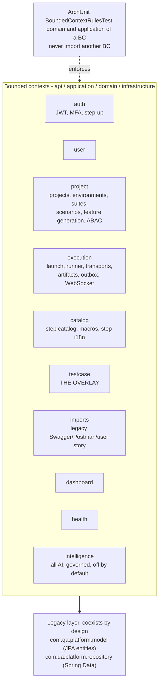

# Bounded contexts

Cross-BC access goes through `infrastructure` ACL adapters only.

## The `intelligence` BC is enforced exactly like every other BC

`BoundedContextRulesTest` has a dedicated section ("Intelligence BC") with five ArchUnit rules:

- `intelligence.domain`/`.application` cannot import project/catalog/execution/imports/dashboard/testcase.
- `intelligence.domain` does not import `intelligence.infrastructure` (standard hexagonal rule).
- `intelligence.infrastructure` ACL adapters may only touch other BCs' **published ports**
  (`catalog.domain.stepcatalog..`, `project.application.port..`, `execution.application.port..`,
  `testcase.application.port..`, `execution.domain.model..`), never their internals.
- No other BC may import `intelligence.domain.port`, `.application.port`, `.application.check`, or
  `.infrastructure`.
- Only classes inside a consuming BC's own `..infrastructure.acl..` package may import anything in
  `com.qa.platform.intelligence..` at all.

## Who actually consumes `intelligence` today

Broader than a single BC — confirmed by a workspace-wide import grep:

- `testcase.infrastructure.acl`: `IntelligenceNormalizationAdapter` (implements `AiNormalizationPort`),
  `IntelligenceStepMappingAdapter`, `IntelligenceDuplicateDetectionAdapter`,
  `IntelligenceFieldMappingAdapter`, `IntelligenceReviewExplanationAdapter`, `IntelligenceProposalAdapter`.
- `catalog.infrastructure.acl`: `IntelligenceMacroAdapter` (`macro.draft` / `macro.name`).
- `execution.infrastructure.acl`: `IntelligenceFailureTriageAdapter`, `IntelligenceRunSummaryAdapter`.
- `imports.infrastructure.acl`: `IntelligenceSpecDraftAdapter`.
- `project.infrastructure.acl`: `IntelligenceEnvironmentHintAdapter`.

Each port is one per capability (`AiNormalizationPort`, `AiStepMappingPort`, `AiDuplicateDetectionPort`,
`AiFieldMappingPort`, `AiReviewExplanationPort`, `AiProposalPort`), not one shared `TestCaseAiPort`.

## Current, real coupling issues (2026-09-22 step audit, still relevant)

- `ScenarioSuggestionEngine` hardcodes Core step ids, including one Spanish id and one deprecated
  component id — a hardcoded id is a contract with Core that no test proves; when Core renames or
  deletes it, the suggestion silently stops matching.
- `GherkinStepRenderer` keys docstring rendering off hardcoded Spanish pattern text plus two regexes —
  pattern text is display data, not identity, and this coupling should key off the step id or a catalog
  flag instead.
- Eleven test classes and five WireMock fixtures embed Spanish step patterns, which will fail as a group
  if Core ever deletes that vocabulary.

## Scale note (as of 2026-10-03)

The backend's migration history has moved well past the historical "V1-V98" figure once cited for this
repository — the AI-specific migrations alone span V102-V107. Regenerate any specific migration-range
claim from `qa-platformBE/src/main/resources/db/migration/` before publishing it; cite the mechanism
(Flyway, forward-only `V*` + `U*` undo) rather than a frozen number.
