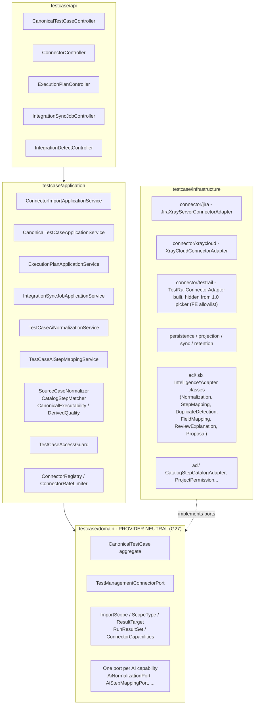

# The overlay bounded context — `testcase`

`TestCaseAiNormalizationService` (`testcase.normalize`) and `TestCaseAiStepMappingService`
(`step.map.propose`) each follow the same propose/accept shape as every AI capability in the product:
`propose()` writes only an `AiProposal`; `accept()` is the only call that mutates the canonical case, and
re-checks `baseVersion` against the case's current `rowVersion` before applying anything.
`TestCaseAiStepMappingService` proposes mappings only for step positions `CatalogStepMatcher` left
unmapped — the deterministic matcher's own mappings are never overwritten, whatever the proposal says.

TestRail's connector adapter (`TestRailConnectorAdapter`, `PROVIDER_TYPE="TESTRAIL"`,
`CONNECTOR_ID="testrail"`) is a `TestManagementConnectorPort` Spring bean, auto-discovered by
`ConnectorRegistry` exactly like Jira and Xray Cloud — there is no special-case wiring to bypass it. The
only gate withholding it from a new project is an FE-side allowlist (see
[../architectureFE/01-rings-and-modules.md](../architectureFE/01-rings-and-modules.md)), not a missing
backend implementation.
