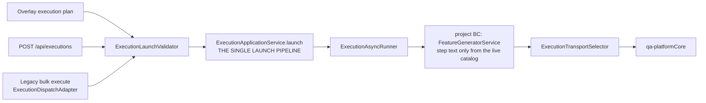
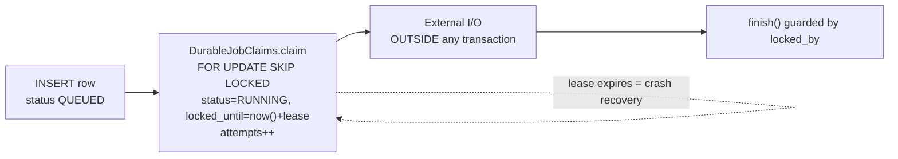

# The launch pipeline and durable jobs

## The launch pipeline — one path for every run



`launch()` validates, checks executor capacity, inserts the `Execution` row `PENDING` inside one
transaction, claims ownership (instance-id + timestamp — the two-instance row-claim pattern), and only
on `afterCommit()` submits the run to `ExecutionAsyncRunner`. `FeatureGeneratorService` is owned by the
`project` BC, not `execution` — a real, intentional cross-BC call to a published service, not an ACL
re-implementation.

## Two durable-job shapes

Every crossing of a process boundary is a claimed row, never fire-and-forget (G4, G5) — but there are
two distinct shapes in the codebase, not one, and conflating them was a documentation bug this rewrite
fixes.

### Variant A — single-phase claim

Used by `integration_import_jobs` (lease PT15M), `integration_sync_jobs` (PT15M) and
`execution_events_outbox` (PT2M): one claim, one lease, work done, finish. The lease must cover the
whole external call.



### Variant B — multi-phase claim with an unleased waiting state

Used by `ai_jobs` (batch provider work, e.g. the batch AI-drafting path). This is the real, shipped
mechanism — not a future design, and the shared `DurableJobClaims` infrastructure was genuinely extended
to support it:

```
QUEUED --(claim, attempts++, submit, release)--> AWAITING_PROVIDER --(no claim held; polled)--> COLLECTING --(claim, poll_count++)--> COMPLETED | PARTIAL
QUEUED --(attempts exhausted)--> DEAD
```

- `AiJobWorkerAdapter` defines **two separate claims** against the same table: `SUBMIT` (claims `QUEUED`
  rows, increments `attempts`) and `POLL` (claims `AWAITING_PROVIDER` rows into `COLLECTING`, increments
  a **separate** `poll_count` column, via a generalized `DurableJobClaims.claimIncrementing(job, lease,
  limit, incrementColumn)`).
- The lease (2 minutes) covers only one phase — submit, or one poll-and-maybe-collect — never the
  provider's multi-hour batch-processing time. While a batch is `AWAITING_PROVIDER`, **no row is locked
  at all**.
- `idempotency_key` (unique per project) is committed at enqueue, before any submit — a crash-recovery
  resubmit is found rather than re-paid for.
- A batch that doesn't complete within a 24h completion window is marked `DEAD` rather than polled
  forever.
- `PARTIAL` is a first-class terminal outcome, not an error — per-item results are recorded separately,
  and a failed item is never retried inside the same job.
- `DurableJobClaims.claimCounting` (used by the single-phase jobs) is now just `claimIncrementing`
  called with the table's own attempts column — the AI job design generalized the primitive rather than
  forking it.

Sweeps that are **not** row-claims, and should not be drawn as such: `AiBudgetSweeper` (reclaims stale
budget reservations on a schedule) and `AiProposalSweeper` (expires/purges proposals via plain
conditional `UPDATE`/`DELETE`) both operate on rows nobody else is touching. `AiInvocationRetentionJob`
purges audit rows daily via `DELETE ... FOR UPDATE SKIP LOCKED` batches — the same shape as the
overlay's own retention jobs, not a claim either.
