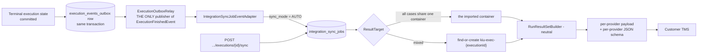

# Result sync

Status: Current-verified (code, 2026-10-03; spot-checked 2026-10-20) | Owner: TBD

At-least-once delivery with idempotent consumers.

The sync job is its own row-claim worker (Variant A, see
[03-launch-pipeline-and-jobs.md](03-launch-pipeline-and-jobs.md)) with its own backoff/jitter schedule,
fully independent of the import job's lease and backoff. A provider failure here never touches the
execution's own terminal result — the two state machines are structurally separate, not just by
convention (working rule 7 in [engineering-rules.md](../../development/engineering-rules.md)).

**Today vs decided scope** (alcance §4.14): only runs launched through the execution plan create a sync
job, and the exclusion note for skipped scenarios is built and then discarded by the sync worker. The
decided target is that recorded runs from a plan, suite or feature write back, every excluded scenario is
reported with its reason before the run, the comment names the case version that ran, and write-back can
be turned off per project (SYN-03, SYN-05, SYN-08, SYN-09).
