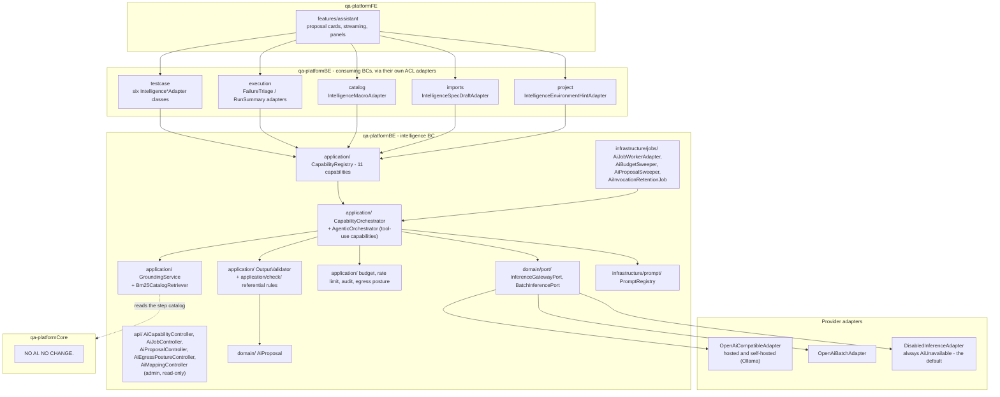

# The `intelligence` bounded context

Status: **implemented, current code** — governed and off by default (`ai.enabled=false`). This replaces
the former `05-proposed-ai-architecture.md`, which described this design as "proposed, not implemented."
It is not: 97 files under `qa-platformBE/src/main/java/com/qa/platform/intelligence/` implement it, with
its own ArchUnit enforcement (see [01-bounded-contexts.md](01-bounded-contexts.md)).

There is no Anthropic adapter — only `OpenAiCompatibleAdapter` (hosted or self-hosted/Ollama) and the
always-on `DisabledInferenceAdapter`.

## The one pipeline every synchronous call takes

`CapabilityOrchestrator.invoke()`, verified order:

```mermaid
flowchart LR
    A["1. authorize<br/>project ABAC, AiAccessGuard"] --> B["2. kill switch<br/>global + per-capability"]
    B --> C["3. route<br/>ModelRouter: tier/pin + egress posture"]
    C --> D["4. rate limit<br/>AiRateLimiter, per capability+project+minute"]
    D --> E["5. budget reserve<br/>AiBudgetPort, reconciled in a finally"]
    E --> F["6. redact<br/>SensitiveText, per RedactionPolicy"]
    F --> G["7. ground<br/>GroundingService, on the redacted text"]
    G --> H["8. render prompt<br/>PromptRegistry, versioned, hashed"]
    H --> I["9. invoke<br/>InferenceGatewayPort, never in a transaction (G4)"]
    I --> J["10. validate output<br/>schema + referential checks"]
    J -->|"schema failure, repairable, 1 attempt"| I
    J --> K["11. persist AiProposal<br/>accepted path only, proposalKind != NONE"]
    K --> L["12. audit<br/>every path that got past step 1, incl. refusals"]
```

Order rationale, each verified against code: authorization runs first so an unauthorized caller can't
learn a capability is enabled, spend budget, or get an audit row in their name. A referential-check
failure is **never** repaired — re-asking the same false claim is how a bounded repair turns into a
loop; only a schema-shape failure gets the one repair attempt. A proposal is written last, after
validation succeeds — an output the checks rejected has nothing for a human to decide.

## Capabilities — 11, as registered in code

| Capability | Tier | Grounding | Redaction | Referential checks | ProposalKind | Batchable | Streamable | maxToolCalls |
|---|---|---|---|---|---|---|---|---|
| `testcase.normalize` | STANDARD | CATALOG_BY_LAYER | BODY | CATALOG_STEP_EXISTS, NO_SOURCE_MUTATION | CANONICAL_DRAFT | yes | no | 0 |
| `step.map.propose` | STANDARD | CATALOG_BY_TEXT | BODY | CATALOG_STEP_EXISTS, PATTERN_ROUNDTRIP | STEP_MAPPING | no | no | 0 |
| `review.explain` | FAST | NONE | TEXT | none | NONE (read-only) | no | yes | 0 |
| `report.summarize` | STANDARD | EXECUTION_RECORD | BODY | none | NONE (read-only) | no | yes | 0 |
| `env.hints.extract` | FAST | NONE | BODY | OUTBOUND_URL_ALLOWED | ENVIRONMENT_HINTS | no | no | 0 |
| `import.duplicates.detect` | STANDARD | NONE | BODY | none | NONE | no | no | 0 |
| `macro.draft` | STANDARD | CATALOG_BY_TEXT | TEXT | CATALOG_STEP_EXISTS, PATTERN_ROUNDTRIP | MACRO | no | yes | 0 |
| `macro.name` | FAST | NONE | TEXT | none | MACRO | no | no | 0 |
| `spec.scenarios.draft` | STANDARD | CATALOG_BY_TEXT | BODY | CATALOG_STEP_EXISTS, PATTERN_ROUNDTRIP | CANONICAL_DRAFT | no | no | 0 |
| `failure.triage` | STANDARD | NONE (reads via tools) | BODY | none | NONE, agentic, opt-in (disabled by default) | no | no | 8 |
| `connector.fieldmap.propose` | STANDARD | NONE (reads via tools) | BODY | none | CONNECTOR_FIELD_MAPPING | no | no | 6 |

No capability currently runs at `DEEP` tier (the enum value exists, nothing is registered at it). Every
capability has a non-blank `fallback` string, enforced by a compact-constructor check — "every capability
has a named deterministic fallback" is structural, not aspirational.

## Governance, each grounded

- **Authorization** — `AiAccessGuard` delegates to `AiAuthorizationPort` -> `ProjectPermissionAiAdapter`
  (ACL to the `project` BC's own permission port).
- **Rate limiting** — `AiRateLimiter`, per capability+project+minute, backed by a shared
  `FixedWindowRateLimiter` — moved off pure in-memory specifically so two backend instances don't each
  grant the full allowance (the "design for two instances" guardrail in action).
- **Budget** — `AiBudgetPort`/`JdbcAiBudgetAdapter`, durable: `ai_budgets` (project, UTC calendar month,
  consumed/reserved tokens) + `ai_budget_reservations` (one row per in-flight call). Reserve and
  reconcile are each their own short transaction around the provider call (G4) — holding one transaction
  across reserve-call-reconcile would serialize all of a project's AI calls on one row.
  `AiBudgetSweeper` reclaims reservations older than a timeout (default 10m), which is what prevents a
  crashed call from permanently shrinking a project's budget.
- **Audit** — `ai_invocations`, one row per invocation including every refusal, hashes only
  (`prompt_hash`, `input_hash`, `output_hash`) — never prompt/response text (G32, G23).
  `AiInvocationRetentionJob` purges past-retention rows daily, independently from the overlay's own
  retention job.
- **Egress posture** — `HOSTED_ALLOWED` (default) / `SELF_HOSTED_ONLY` / `AI_DISABLED`, a
  `projects.ai_egress_posture` column — configuration, never inference, never classified by a model.
  `ModelRouter` refuses (not downgrades) a `SELF_HOSTED_ONLY` project routed to a hosted provider.
  Project-write-permission-settable via `AiEgressPostureController` — "the party whose data it is," not
  admin-only.
- **Referential checks** (`application/check/`, fail-closed; a declared-but-unimplemented check fails
  startup):
  - `CatalogStepExistsRule` — every proposed `stepId` resolves in the live catalog and is available.
  - `PatternRoundtripRule` — the strongest check: renders the catalog pattern with the proposed
    parameters and matches it back with the same Cucumber expression engine the deterministic matcher
    uses, including Scenario Outline substitution — proves a proposal is renderable before a human sees
    it, not just schema-valid.
  - `OutboundUrlAllowedRule` — walks the entire output tree for anything URL-shaped and delegates to the
    one `OutboundUrlPolicy` (-> Core `OutboundHostPolicy`) — never a duplicated address check (G2).
  - `NoSourceMutationRule` — every non-null `source` in a draft's steps must be an unchanged,
    at-most-once-used source from the input's existing steps.
  - `LOCALE_KEYS_UNCHANGED` is declared in the `ReferentialCheck` enum but has **no implementing rule**
    today — harmless, since nothing currently declares it, but a gap to close if a future capability
    touches i18n content and assumes the enum means there is a guard.

## Grounding

`GroundingService` + `Bm25CatalogRetriever`: a from-scratch lexical BM25 implementation (not an external
library), indexing the pattern plus all three locales' name/description per step, so a Spanish case
sentence can retrieve a step whose English pattern then reaches the prompt unchanged. Deliberately not
vector/embedding-based — the catalog corpus is small enough that one isn't needed, and the retriever
port is retrieval-shaped so that stays a future adapter swap, not a rewrite. Modes: `NONE`,
`CATALOG_BY_LAYER` (deterministically id-sorted, for cacheable prompt prefixes), `CATALOG_BY_TEXT`
(BM25 top matches), `EXECUTION_RECORD` (one execution's redacted scenario results plus artifact-kind
metadata).

## The agentic path

`failure.triage` and `connector.fieldmap.propose` are the only two capabilities with `maxToolCalls > 0`,
run through a separate `AgenticOrchestrator` (not a flag on the synchronous orchestrator) with the same
guarantee order — authorize, kill switch, route, rate limit, budget, redact, versioned prompt, fail-closed
validation, audit — except the budget reservation covers the **whole loop**
(`maxOutputTokens * maxToolCalls`). `ToolLoop` bounds the loop in code, a hard stop, never a prompt
request. Every tool is read-only, scoped by ids the orchestrator itself supplies (never ids the model
provides — an injected instruction has nothing to aim), and declared per-capability: `ExecutionRecordTools`
(`list_scenario_results`, `list_evidence_kinds`, scoped to failure triage) and `ConnectorFieldTools`
(`list_unmapped_fields`, `sample_unmapped_fields`, scoped to field-mapping proposals — reads a snapshot
rather than live-calling the provider).

## Human-in-the-loop

`AiProposal`/`AiProposalStatus`: `PROPOSED -> {ACCEPTED, ACCEPTED_WITH_EDITS, REJECTED, SUPERSEDED,
EXPIRED}`, all terminal, never reopened. `baseVersion` is carried from the call and re-checked by the
*owning* BC's apply path — `intelligence` itself is read-and-decide only; applying a proposal is
knowledge that belongs to the context that owns the subject. `confidence` is shown and never acted on —
no auto-apply threshold exists in code. `AiProposalSweeper` expires due `PROPOSED` rows and purges old
decided ones on separate schedules.

## Streaming

`StompAiStreamAdapter` publishes `AI_DELTA`/`AI_COMPLETED`/`AI_FAILED` frames on
`/topic/projects/{projectId}/ai/{streamId}`, reusing the existing STOMP auth/authz machinery
(re-checked every 30s per G14) rather than a new transport. A delta is itself redacted, since it is the
model echoing customer content back, partial or not. Streaming never changes what's validated — the
orchestrator always validates the complete returned text, never a chunk.

## Degradation table

| Condition | Response |
|---|---|
| `ai.enabled=false` or capability kill switch | 503 `AI_DISABLED` |
| No provider mapped / unreachable | 503 `AI_UNAVAILABLE` |
| Project egress posture refuses every provider | 503, code `AI_EGRESS_REFUSED` |
| Provider call failed | 502 `AI_PROVIDER_FAILED` |
| Output invalid after one repair attempt | 422 `AI_OUTPUT_INVALID` |
| Budget exhausted | 429, code `AI_BUDGET_EXCEEDED`, `Retry-After` to period rollover |
| Rate limited | 429, code `AI_RATE_LIMITED`, `Retry-After` to window rollover |
| Proposal stale at apply time (owned by the consuming BC, not `intelligence`) | 409 `AI_PROPOSAL_STALE` |

`AiAvailabilityService` is the single source the console reads to decide whether to show an AI
affordance before calling anything — three cheap checks (kill switch, router probe, budget), no
provider call — one list endpoint, not a per-feature 503 a screen has to interpret.

## API surface (read-mostly)

`GET /api/projects/{projectId}/ai/capabilities` (the one list endpoint above);
`GET .../ai/jobs`, `GET .../ai/jobs/{jobId}` (read-only — a job is enqueued by the owning BC's own
adapter, never through this controller); `GET .../ai/proposals`, `GET .../ai/proposals/{id}` (read-only —
deciding is an endpoint of the owning BC); `GET`/`PUT .../ai/egress-posture` (project write permission,
not admin-only); `GET /api/admin/ai/mapping` (admin-only, never returns a key — shows tier/provider/model
plus per-provider feature flags).
