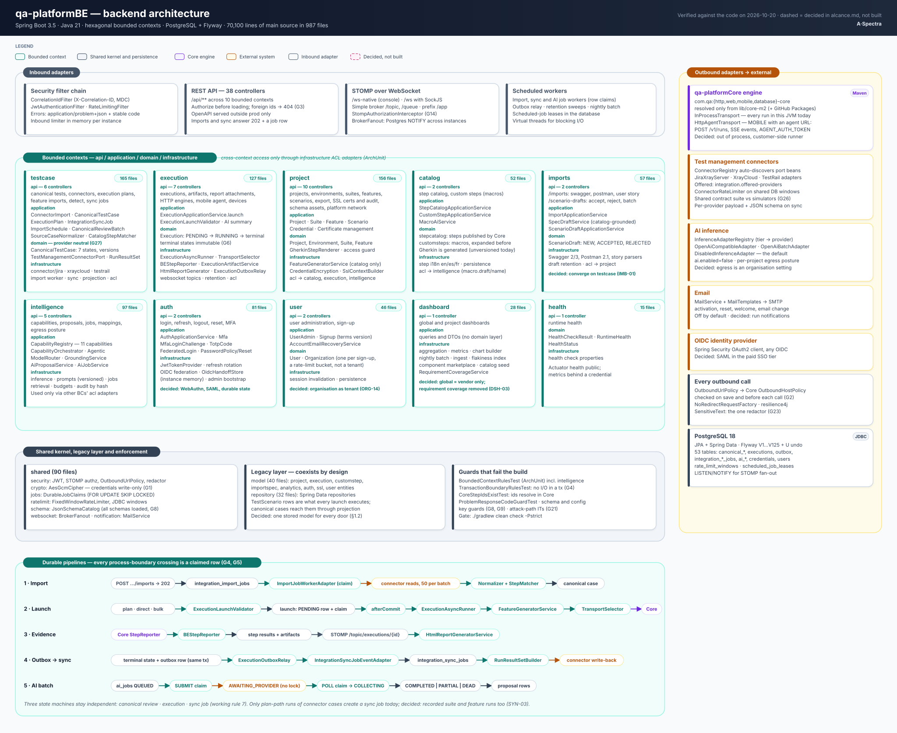

# qa-platformBE — architecture

Spring Boot 3.5, Java 21 (virtual threads on), hexagonal architecture, PostgreSQL via Flyway. The
backend: it owns every integration and all AI in the product.

Status: Current-verified (code, 2026-10-20) unless a section says otherwise | Owner: TBD

Anything not shown here: the code, `qa-platformBE/AGENTS.md` and `qa-platformBE/.claude/CLAUDE.md`, and
the shared [platform.md](../../architecture/platform.md).

The diagram above ([qa-platformBE.svg](qa-platformBE.svg)) is the one-page view of this repository; the files below go
deeper on each part.

| File | Scope |
|---|---|
| [01-bounded-contexts.md](01-bounded-contexts.md) | The bounded-context map, legacy coexistence, ArchUnit enforcement — `intelligence` included as a first-class BC |
| [02-overlay-bounded-context.md](02-overlay-bounded-context.md) | The `testcase` BC in detail: api/application/domain/infrastructure |
| [03-launch-pipeline-and-jobs.md](03-launch-pipeline-and-jobs.md) | The single launch pipeline and the two durable-job shapes (single-phase and multi-phase row claims) |
| [04-result-sync.md](04-result-sync.md) | Outbox to sync job to TMS, at-least-once with idempotent consumers |
| [05-intelligence-bounded-context.md](05-intelligence-bounded-context.md) | The `intelligence` BC, fully current (not proposed): pipeline, capabilities, governance, provider adapters |
| [06-cross-cutting.md](06-cross-cutting.md) | Errors, authz, secrets, outbound, observability, runtime, scale |

## Decided changes that reshape this backend

From [alcance.md](../../alcance.md), not yet built. Each is a requirement in
[requirements.md](../../requirements.md).

| Change | Requirements |
|---|---|
| The `imports` drafts converge on the `testcase` canonical model; Gherkin paste goes through the same stored model | IMB-01, IMB-02, AUT-03 |
| Execution moves out of process onto the customer-side runner | EXE-02, NFR-05 |
| The organisation becomes the tenant: an organisation column on project-owning data, tenant-scoped aggregates, a customer organisation administrator | ORG-03, ORG-14, ORG-15 |
| One append-only audit table with the kind of actor; the review trail also writes to it | AUD-01..AUD-06, REV-04 |
| The outbox gains a consumer registry; notifications become durable delivery jobs | NTF-01..NTF-03 |
| Evidence moves to S3-compatible object storage; sign-in and two-factor state become durable | EVD-09, IAM-12, NFR-06 |
| Requirement coverage is removed end to end, including `requirement_links` | DSH-03 |
| Macros are versioned; executions record the case version that ran | MAC-02, EXE-10 |
