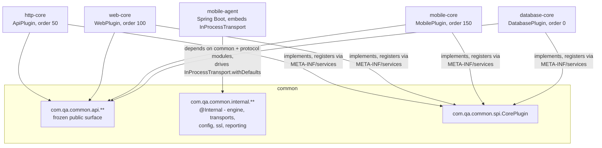

# Modules and the plugin-host runtime

Status: Current-verified (code, 2026-10-03; spot-checked 2026-10-20) | Owner: TBD

## Modules

6 Gradle subprojects (`qa-platformCore/settings.gradle`): `common`, `http-core`, `web-core`,
`mobile-core`, `database-core`, `mobile-agent`. `coreVersion` (`gradle.properties`) is the version
`qa-platformBE` pins in its own `gradle.properties`.

`common` has three packages, each a distinct contract:

- `com.qa.common.api.**` — the **frozen public surface** (`config`, `driver`, `exception`, `fixtures`,
  `logging`, `pool`, `redaction`, `reporter`, `runtime`, `security`, `stepcatalog`, `transport`). Every
  class outside `internal` is fair game for BE and standalone consumers.
- `com.qa.common.internal.**` — implementation detail. Every public class must carry
  `@com.qa.common.api.Internal`; an ArchUnit test (`ApiInternalBoundaryTest`) fails the build if an
  outside consumer imports one without being whitelisted. Holds the engine, both transports, config
  loading, SSL, reporting.
- `com.qa.common.spi.CorePlugin` — the one SPI interface every protocol module implements.

The four protocol modules (`http-core`, `web-core`, `mobile-core`, `database-core`) each: implement
`CorePlugin` and register it via `META-INF/services/com.qa.common.spi.CorePlugin`; implement
`StepCatalogProvider` and register it via
`META-INF/services/com.qa.common.api.stepcatalog.StepCatalogProvider`; and depend only on `common.api`
plus their own protocol libraries (Apache HttpClient/Playwright for http-core; Playwright for web-core;
Appium for mobile-core; JDBC/Hikari for database-core). `mobile-agent` is different in kind: a Spring
Boot application that **embeds** Core as a library rather than extending it (see
[02-transports-and-execution.md](02-transports-and-execution.md)).

## The plugin-host runtime

Discovery: `CucumberRuntimeEngine.withServiceLoader()` loads every `CorePlugin` via `ServiceLoader`,
sorts by `getHookOrder()` ascending, and builds a `DefaultLifecycleManager` + `StepDiscoveryService`
from the sorted list.

Confirmed orders: `DatabasePlugin` 0 (tags `@db @database @sql @jdbc`), `ApiPlugin` 50
(`@api @rest @http @service`), `WebPlugin` 100 (`@web @ui @browser @playwright`), `MobilePlugin` 150
(`@mobile @ios @android @appium`).

**What "lower order first" actually gates** (`CucumberRuntimeEngine.execute`): the engine iterates the
order-sorted plugin list once per run, calling `onSuiteStart` ascending, then — in a `finally` block —
calling `onSuiteEnd` on only the plugins whose `onSuiteStart` succeeded, in **reverse** order (LIFO), so
cleanup is symmetric. A failing suite hook is caught and turned into `ExecutionResult.Status.ERROR`,
never an uncaught exception (fail-closed, G20). A failing `registerServices` call during
`DefaultLifecycleManager.initialize()` destroys every already-registered service before rethrowing, so
no half-registered service leaks.

This is suite-level ordering only. A **second, tag-based activation layer** governs per-scenario
behavior: `DefaultLifecycleManager.resolveActivePlugins(tags)` parses the run's Cucumber tag expression
and computes, per plugin, whether some satisfying assignment of the mentioned tags would make that
plugin's activation tags true — a plugin whose tag never appears is active only when some accepted
assignment carries no layer tag at all (an untagged scenario runs every plugin). At the per-scenario
level, `onScenarioStart`/`onScenarioEnd` instead resolve active plugins from the scenario's own tags: a
scenario without any plugin's activation tag runs every plugin; one with a tag runs only the matching
plugin(s), in LIFO order for `onScenarioEnd`.

## The stateless engine

`CucumberRuntimeEngine` holds exactly two fields (`lifecycleManager`, `discoveryService`), both set at
construction and never mutated. Every `execute(ExecutionRequest)` call:

1. Builds a fresh `InMemoryResultCollector`.
2. Calls `lifecycleManager.initialize(request)` — builds a brand-new `ExecutionContext` (new
   `ServiceRegistry`, `VariableStore`, `EventBus`, and the request's `CancellationSignal`) and activates
   it on a `ThreadLocal`.
3. Runs Cucumber's own runtime, registering the collector plus a `ScenarioLifecycleBridge` plus any
   caller-supplied listeners.
4. Builds the immutable `ExecutionResult` from the collector and returns it.
5. In `finally`: reverse-order `onSuiteEnd`, then `lifecycleManager.shutdown(context)` —
   `context.cleanup()` clears variables, destroys every `AutoCloseable` service, clears the event bus,
   and deactivates the `ThreadLocal`.

Nothing from one `execute()` call is visible to another: no shared mutable field on the engine, one
`ExecutionContext` per call, one `CancellationSignal` per call. That is the whole concurrency-isolation
story, and it holds whether the caller is BE's JVM, a standalone CLI run, or the mobile-agent's own
embedded engine.
