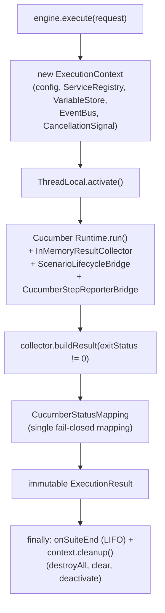
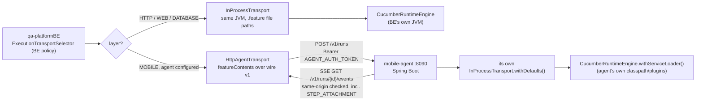

# Transports and execution internals

Status: Current-verified (code, 2026-10-03; spot-checked 2026-10-20) | Owner: TBD

## Per-run execution internals

`ExecutionContext` is a facade over four collaborators, held as final fields:

- `ExecutionConfig` — immutable run config (tags, environment, SSL, properties including
  `qa.execution.managed` / `qa.outbound.allow-private-hosts`).
- `ServiceRegistry` — thread-safe lazy DI container, one instance per run; plugins register their
  drivers/helpers here in `registerServices`.
- `VariableStore` — shared mutable state between steps of the same run, cleared on cleanup.
- `EventBus` — pub/sub; publish logs and swallows subscriber exceptions so one bad listener can't break
  the run.
- `CancellationSignal` — see G19 in [04-security-guardrails.md](04-security-guardrails.md).

Access is via `ExecutionContext.current()` (`ThreadLocal`-backed) or `requireCurrent()`.

**Reporting path.** `StepReporter` is the semantic contract BE implements (`BEStepReporter`) —
`onScenarioStarted/onStepStarted/onStepPassed/onStepFailed/onStepSkipped/onStepAttachment/
onScenarioCompleted/onExecutionCompleted`, every method a no-op default, documented thread-safe-required.
Two production bridges terminate in the same contract: `InProcessTransport.CucumberStepReporterBridge`
(a `ConcurrentEventListener` registered directly on Cucumber's own runtime, with step-text correlation
for attachments and failed-hook-as-failed-step synthesis) and `EventBusStepReporterAdapter` (the generic
translator from Core's internal `EventBus` model to the same `StepReporter` calls).

**Result.** `InMemoryResultCollector` applies the single fail-closed mapping in `CucumberStatusMapping`
(see G20) and returns an immutable `ExecutionResult` — status, counts, duration, and
`reportedSkippedScenarios` as an optional int (absent/UNKNOWN is a distinct state from a reported zero,
used to tell an older mobile-agent payload from a real zero).

## Cooperative cancellation

`CancellationSignal` is a one-shot `AtomicBoolean`, one per run, carried on the `ExecutionRequest`,
installed on the `ExecutionContext`. `RunCancellationHooks` is glue added to every run unconditionally —
appended after SPI-derived or explicit glue, because no per-module hook class loads on every run, so
only a package every run shares can be a universal cancellation point. Two hooks: a `@Before(order=0)`
aborts before any module hook opens a session for a scenario about to be skipped anyway; a
`@BeforeStep` aborts mid-scenario. Both throw `TestAbortedException` so Cucumber reports `SKIPPED`, not
a synthesized failure.

## Two transports

Both implement `ExecutionTransport` (`AutoCloseable`); `submit(config, featurePaths, reporter)` returns
an `ExecutionHandle(executionId, CompletableFuture<ExecutionResult>, cancelRunnable)`.

**`InProcessTransport`** — same JVM. `withDefaults()` builds its own
`CucumberRuntimeEngine.withServiceLoader()` and a daemon cached thread pool; `withEngine(engine)` reuses
a caller-managed engine. `submit()` wraps the engine call in the executor, using an atomic "terminal"
flag to guarantee exactly one terminal outcome between normal completion and cancel. Cancel trips the
`CancellationSignal` first (the actual stop mechanism — Cucumber ignores `Thread.interrupt()` mid-step),
then cancels the future, then interrupts the underlying future as a backstop for I/O-parked threads.

**`HttpAgentTransport`** — remote, wire v1. `submit()` reads each feature file's **contents** (never a
path — throws on a duplicate basename rather than silently overwriting), `POST {baseUrl}/v1/runs`, then
opens a same-origin-checked SSE stream on the `eventsUrl` the agent returned (the bearer token is
attached to that request too). Each `AgentEventDto`
(`SCENARIO_STARTED/STEP_STARTED/STEP_PASSED/STEP_FAILED/STEP_SKIPPED/STEP_ATTACHMENT/
SCENARIO_COMPLETED/EXECUTION_COMPLETED/EXECUTION_ERROR`, with a default no-op for forward-compatible
unknown types) is translated into the same `StepReporter` calls. Cancel: trips the future, stops the
local SSE reader, fires an idempotent `POST /v1/runs/{id}/cancel` asynchronously with a 5s timeout.
Nothing restricts this transport to the MOBILE layer — that routing choice is BE policy
(`ExecutionTransportSelector`), not a Core constraint; `HttpAgentTransport` is a generic remote runner
for any feature content.

**mobile-agent** (Spring Boot, port 8090 by default) is **not** a mobile-specific engine:
`AgentConfig.executionTransport()` is a plain `InProcessTransport.withDefaults()` — the agent embeds the
same engine any JVM carrying the Core jars would build, discovering whatever `CorePlugin`s are on its
own classpath (in practice mobile-core at minimum, for Appium/device access). `AgentExecutionService`
keeps a concurrent map of run sessions, enforces `agent.limits.max-concurrent-runs` (429 when exceeded),
materializes feature contents to a per-run workspace directory (cleaned up even on failure), and
releases a session either on the SSE terminal event or after an orphan TTL (default 300s).
`EventsController` (`GET /v1/runs/{id}/events`) is single-subscriber-at-a-time via a subscriber
generation counter — a reconnecting client takes over and the old drain loop hands back any undelivered
event. Auth: every `/v1/**` request needs `Authorization: Bearer <AGENT_AUTH_TOKEN>`,
constant-time-compared; the agent refuses to start without a token outside its `DEV` profile — a hard
startup failure, not a warning.

## The frozen consumer-surface contract

`qa-platformCore/http-core/src/test/java/com/qa/httpcore/arch/ConsumerSurfaceContractTest.java` is a
real, running JUnit test — not documentation — that pins, via method references assigned to explicit
functional-interface types, every member outside `com.qa.common.api.**` that `qa-platformBE` is known to
call. A rename, parameter change or return-type change breaks the **Core** build, not the backend's.

| Test method | What it pins |
|---|---|
| `engineDiscoveryAndTransportsBackendCalls` | `CucumberRuntimeEngine.withServiceLoader/getDiscoveryService`, `StepDiscoveryService`, `InProcessTransport.withEngine`, `HttpAgentTransport.builder/bearerToken/build`, `ExecutionTransport.submit/close`, `ExecutionHandle`, `ExecutionResult` accessors |
| `stepCatalogMembersBackendReads` | `StepDefinitionInfo`/`ParamInfo` accessors, `StepCatalogProvider`/`StepCatalogEntry`/`ParamSpec` |
| `configurationAndSecurityMembersBackendCalls` | `ExecutionProfile`, `HttpEngine`, `SensitiveDataRedactor`, `FixturePathResolver.ROOT_KEY`, `OutboundHostPolicy::check`/`.MANAGED_KEY`/`.ALLOW_PRIVATE_HOSTS_KEY`, `JdbcHostPolicy::hosts`, `ExecutionConfig.Builder`, `SSLContextFactory` |
| `reporterCallbacksBackendOverrides` | every `StepReporter` method, `ExecutionContext.current/service` |
| `httpReportingMembersBackendCalls` | HTTP client/response reporting accessors, `HttpDetailRedactor.build`, `HttpDetailData`, `HttpStepDetail` |
| `htmlReportBridgeBackendBuilds` | `ExecutionData/ScenarioData/StepData/AttachmentData/EnvironmentDetails` constructors, `ReportGeneratorPort.generateHtml`, `TestStatus` |
| `backendReadsTheMobileReadinessReport` | `MobileReadinessReport` and nested `Agent/Appium/Probe/Evidence` records (`GET /v1/readiness`) |
| `backendTests...Members` (two methods) | members used only by BE's own test doubles/builders |

Rule: when BE starts calling a new Core member, it is added here.
