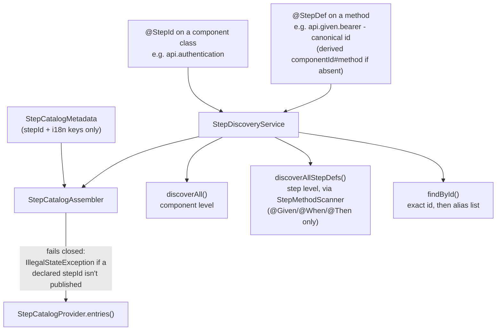

# The step catalog

Status: Current-verified (code, 2026-10-03; spot-checked 2026-10-20) | Owner: TBD

## The three id namespaces

1. **`@StepId`** — on a `StepComponent`-implementing class — the component id, e.g.
   `api.authentication`. `StepComponent.getId()` reads it, falling back to a lower-cased, dot-joined
   derivation of the class name when absent. Also carries `deprecated()`/`replacedBy()` for
   component-level migration.
2. **`@StepDef`** — on a `@Given`/`@When`/`@Then`-annotated method — the canonical step id, e.g.
   `api.given.bearer`. `StepMethodScanner.resolveStepDefId()` uses the explicit value when present, else
   derives `{componentId}#{methodName}` (less stable across refactorings). Also carries
   `aliases()`/`replacedBy()`/`deprecated()`/`displayName()`.
3. **`StepCatalogProvider` / `StepCatalogMetadata`** — the curated i18n layer. A provider's metadata is
   deliberately thin: `stepId`, `categoryKey`, `descriptionKey`, `params` only — pattern, phase and
   availability are not restated here (see the catalog-consistency fix below).

## Discovery and resolution

`StepDiscoveryService`:

- `discoverAll()` — component level, flat-maps every plugin's components.
- `discoverAllStepDefs()` — step level, lazily computed once, via `StepMethodScanner.scanAll`. A step
  class shared by more than one component is scanned **once**, under the first component that
  references it; the other components' derived `{componentId}#{method}` ids become **aliases** of the
  single canonical entry rather than duplicate entries.
- `findById(stepId)` — tries an exact `stepDefId` match first, then falls back to searching every step's
  alias list — this is how a persisted scenario referencing an older derived id keeps resolving after a
  refactor.

`StepMethodScanner` only recognizes `io.cucumber.java.en.{Given,When,Then}` (correctly handling
Cucumber's `@Repeatable` stacking of alternate language routes under one `@StepDef`).
**`@And`/`@But` are not scanned because their BDD phase is statically ambiguous** — a real, current
limitation, not a historical one.

## The catalog-consistency fix

`StepCatalogAssembler.assemble(plugin, layer, metadata)` is the mechanism each module's
`StepCatalogProvider` now runs through. It replaced an earlier design where a module hand-duplicated
pattern/phase/availability in its own metadata, which could drift from what the engine actually
publishes — a prior audit found web entries advertising a pattern the engine did not publish, so a
scenario built in the console rendered a line no step could match. The fix: build a map of
`stepId -> StepDefinitionInfo` from what the engine actually publishes, then for every declared
`StepCatalogMetadata` entry either look up its real pattern/phase/availability from that map, or
**throw `IllegalStateException` at class-init time** if the declared `stepId` doesn't exist in the
engine's published set. This is a build-time, fail-closed guard, not a lint script — a module that
drifts cannot load.

Raw counts are dated and drift between sessions; regenerate from `COMPONENTS.md`/`cli-smoke.sh` before
quoting a specific coverage percentage. What is structural and durable is the fix itself: a single
source of truth for pattern/phase/availability, enforced at class-load time, replacing hand-duplicated
metadata that could silently go stale.

## Frozen patterns (G34)

Pattern text is a free-form Cucumber Expression string passed as the `@Given`/`@When`/`@Then` value —
majority Spanish, some English, deliberately mixed (e.g.
`"agrego el query param {string} con valor {string}"`). There is no separate Spanish annotation package
in use — Spanish lives in the pattern text itself, not in `io.cucumber.java.es.*`. The catalog's
**displayed** pattern field for the console UI is always English (the literal contract Cucumber uses to
match the Java step definitions, never translated); the actual Gherkin text a scenario is authored and
persisted in may be Spanish. A step's real identity is its `stepDefId`, not its pattern string — which
is exactly why translating a pattern is forbidden under G34: a stored scenario references the step via
its id, but Cucumber still matches text against the pattern at run time, so changing a pattern breaks
every scenario already authored against it.
