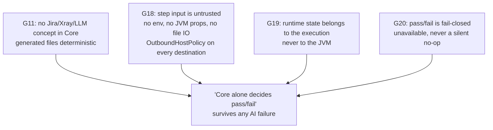

# Security guardrails

BE feeds Core two kinds of untrusted input: Gherkin step text/parameters (written by a QA, imported
from a TMS, or possibly AI-suggested then human-approved) and destination URLs those steps act on.
Core's job is to execute that input deterministically without ever becoming a vector for SSRF,
env/credential leakage, or a false `PASSED`.

## G11 — no provider/TMS/LLM concepts in Core

Confirmed by package scan: no Jira/Xray/Postman/OpenAI/Anthropic/provider-named package exists anywhere
under `common`, `http-core`, `web-core`, `mobile-core`, `database-core` or `mobile-agent`. `mobile-agent`
is a Spring Boot HTTP service, but it is still pure Core — it embeds `InProcessTransport.withDefaults()`
and adds nothing AI- or TMS-shaped; its only domain concepts are runs, sessions, devices and readiness
probes. The `intelligence` bounded context adds **nothing** to this repository; the only Core-adjacent
AI-era work is regenerating i18n step-description resources.

## G18 — step input cannot reach env/files/JVM properties; outbound destinations are validated

Two separate mechanisms:

1. **Step parameters are plain typed Cucumber bindings.** `StepMethodScanner` turns pattern tokens
   (`{string}`, `{int}`, ...) into ordinary Java method parameters by position; nothing in that path
   resolves a parameter against `System.getenv`/`System.getProperty`. A step's string argument is
   exactly the literal text in the `.feature` file.
2. **`VariableInterpolator`** does read `System.getProperty`/`System.getenv`, but this is scoped to
   `ConfigLoader` value resolution — trusted deployment configuration (e.g. `${DB_HOST}` in a properties
   file). The caller explicitly does **not** interpolate values from `ExecutionContextSource` — i.e.,
   request-scoped/run-time config (where less-trusted, BE-supplied values land) is excluded from
   interpolation by design. Step text never touches env/JVM properties; only trusted static
   configuration files do, through a narrow interpolator that skips request-scoped values.

**`OutboundHostPolicy`** is the actual destination-validation enforcement, and it is conditional on the
run being "managed": it does nothing at all unless the config carries `qa.execution.managed=true` — a
standalone/unmanaged Core run is not checked, by design. For a managed run:

- **Always denied, regardless of config**: link-local (`169.254.0.0/16`, `fe80::/10`) and three specific
  cloud-metadata addresses.
- **Denied unless `qa.outbound.allow-private-hosts=true`**: loopback, site-local (`10/8`, `172.16/12`,
  `192.168/16`), any-local, multicast, CGNAT (`100.64.0.0/10`), `0.0.0.0/8`, and IPv6 unique-local
  (`fc00::/7`).
- **Numeric-literal and embedded-IPv4 bypasses are closed**: a host whose last label is numeric is
  parsed as a WHATWG-style IPv4 literal (decimal/octal/hex/short forms) exactly as a browser would read
  it, rather than handed to DNS; an IPv4 address embedded in an IPv6 address (mapped, compatible, NAT64,
  6to4) is extracted and checked under the IPv4 rules too. Both exist specifically to stop "looks like a
  public hostname, resolves to a private/metadata address" SSRF.
- `resolveAllowed()` returns the already-checked addresses so a caller can connect to those rather than
  re-resolving, closing most of a TOCTOU DNS-rebind gap (documented as only partially closed for the
  Playwright HTTP engine, which re-resolves internally).
- `JdbcHostPolicy.hosts()` shares the same host-extraction logic for JDBC connection strings — one
  parser for both the step-execution path and the backend's environment-save check.

## G19 — runtime state belongs to the execution, never the JVM

`CancellationSignal`'s own contract states it directly: there is deliberately no shared "never
cancelled" instance, so no cancellation state outlives the run it belongs to. Every `ExecutionRequest`
factory that doesn't take an explicit signal builds a fresh one. Combined with a brand-new
`ServiceRegistry`/`VariableStore`/`EventBus` per `ExecutionContext`, `ThreadLocal`-scoped context
activation, and full teardown in `cleanup()` — nothing survives one run into the next, and nothing is
keyed by JVM identity. This is also why "two backend instances sharing one database" needs no
JVM-level coordination from Core's side: Core holds no state that could conflict across instances; the
backend's job (durable job rows, row claims) is a separate, higher layer.

## G20 — fail-closed pass/fail; unavailable steps never silently succeed

Single mapping point, `CucumberStatusMapping`, used identically by both transports' reporting paths:

- Step/scenario: `FAILED`, `UNDEFINED`, `AMBIGUOUS`, `PENDING` all count as failure — an undefined step
  (no matching step definition) is a failure, not a skip and not a pass.
- Run: any failed scenario -> `FAILED`; **zero passed and zero failed** (nothing was verified, or every
  scenario was skipped) -> `ERROR`, never `PASSED`; a run-level hook failure or a non-zero exit status
  without any failed scenario -> `ERROR`, with an explicit diagnostic message for this case.
- `@StepUnavailable` (on a method or whole step class) flips availability to `false` and excludes the
  step from the catalog's offer set — an environment-unavailable capability is never silently presented
  as runnable.

## Tying it together

"Core alone decides pass/fail" rests on the combination of: G11 (nothing provider/LLM-shaped exists to
short-circuit the verdict), G20 (the single fail-closed status mapping above, applied identically across
both transports), and the structural fact that BE can only ever hand Core Gherkin text/feature content —
never a result. The guardrail is not a policy statement; it is the shape of the
`ExecutionTransport`/`StepReporter`/`ExecutionResult` contracts themselves.
