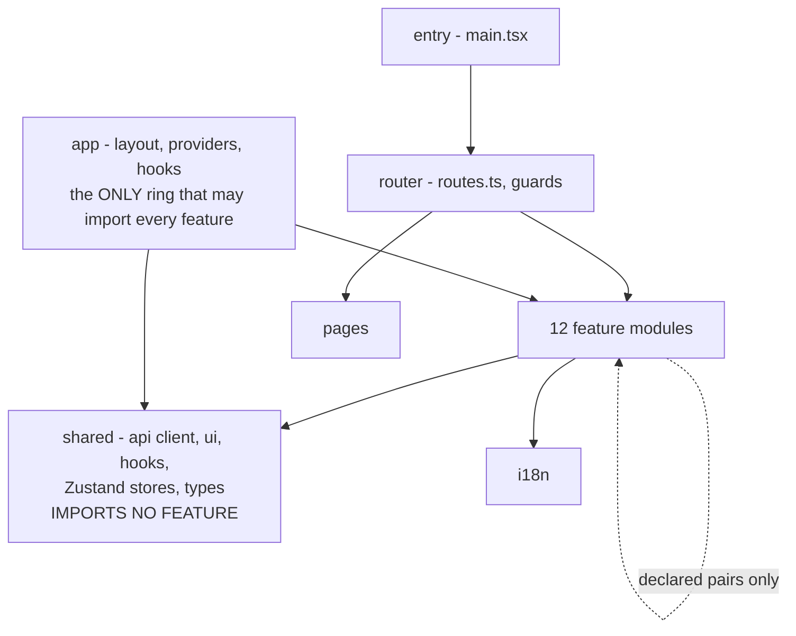
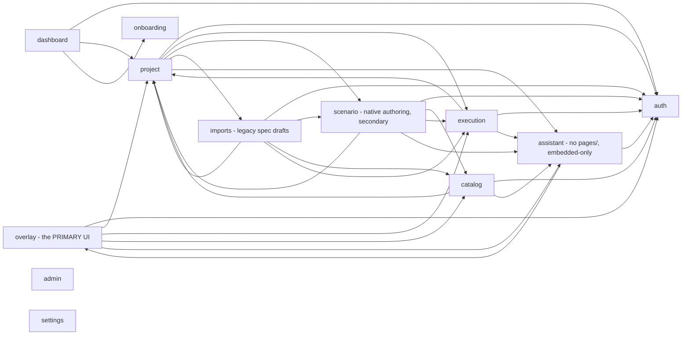

# Rings and modules

Status: Current-verified (code, 2026-10-03; spot-checked 2026-10-20) | Owner: TBD

## Four rings, enforced by lint

`eslint-plugin-boundaries` runs with `default: 'disallow'` — an import is illegal unless a rule permits
it (guardrail G12). Configured in `qa-platformFE/eslint.config.js` (flat config — `.eslintrc.cjs` no
longer exists; ESLint 10 removed eslintrc support).

`shared` has no allow-rule to any feature — that is what stops a "shared" folder becoming a second
application. Layout lives in `app`, not `shared`, for the same reason.

## Feature modules and their declared cross-imports

There are **12** feature-module elements declared (`boundaries/elements` in `eslint.config.js`), not 11:
`auth, project, execution, dashboard, scenario, catalog, imports, onboarding, admin, settings, overlay,
assistant`. `assistant` exists in code — panels embedded in five screens — but had not yet been added to
this diagram before this rewrite.

Every arrow is an explicit rule in `eslint.config.js` with a comment saying why. Notable, decision-backed
rules:

- `project` -> `assistant`: the integrations page hosts the connector field-mapping panel.
- `execution` -> `assistant`: the results page hosts the run assistant panel; no AI logic lives in
  `execution` itself.
- `scenario` -> `assistant`: the feature page hosts the environment-hints panel; no AI logic lives in
  `scenario` itself.
- `catalog` -> `assistant`: the macro editor asks whether `macro.draft` can run before offering it; no AI
  logic lives in `catalog` itself.
- `overlay` -> `assistant`: the overlay hosts the proposal card; `project` must **not** import `overlay`
  (an explicit one-way rule).
- `assistant` -> `overlay`: `assistant` imports only `overlay/types.ts` (`CanonicalTest`,
  `CanonicalStep`) — nothing else. `assistant` -> `shared`, `auth`: ordinary.
- `assistant` owns every AI proposal concern; no other feature holds one, which is what keeps the AI
  surface in one place.

## Real consumers of `assistant`, confirmed by import grep

Exactly five screens, matching `requirements.md`'s own count ("panels embedded in five screens"):

| Consumer | What it imports |
|---|---|
| `catalog/components/MacroEditorModal.tsx` | `useAiCapabilities` hook only — no panel; gates its own inline AI-description affordance for `macro.draft` |
| `project/pages/ProjectIntegrationsPage.tsx` | `FieldMappingPanel`, `EgressPosturePanel` |
| `scenario/pages/FeatureDetailPage.tsx` | `EnvironmentHintsPanel` |
| `execution/pages/ExecutionResultsPage.tsx` | `RunAssistantPanel` |
| `overlay/components/CaseDetail.tsx` | `BlockingReasons`, `ProposalCard`, `StepMappingProposals` |
| `overlay/components/ReviewBatchPanel.tsx` | `BulkProposalActions`, `DraftBatchActions` |
| `overlay/hooks/useExecutionOverlayVM.ts` | `useCaseAssistantVM`, `useStepMappingAssistantVM` |
| `overlay/pages/ExecutionOverlayPage.tsx` | `ImportAssistantPanel` |

The cross-import map in the eslint config is complete and consistent with actual usage — nothing is
imported that isn't declared, and nothing declared goes unused. `assistant` has no `pages/` directory —
it is never a routed screen, only embedded UI.

## G-10: pages and components never import `api` directly

Enforced mechanically, not just by convention: an ESLint `no-restricted-imports` rule forbids every
page/component file from importing `**/api`, `**/api/**`, or `**/shared/api/client`. A query/data hook
must sit between a page and the API client. `useExecutionOverlayVM.ts` is the reference implementation —
the only overlay file that imports `../api/overlay`.
