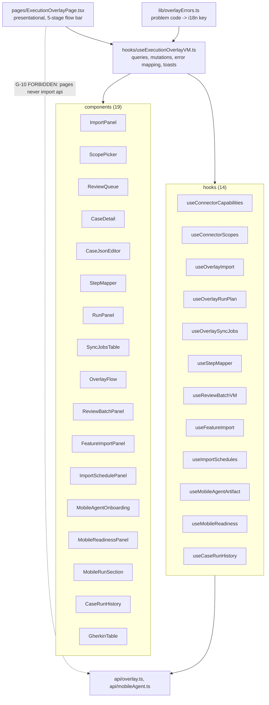

# The overlay feature — page, VM, components

Status: Current-verified (code, 2026-10-03; spot-checked 2026-10-20) | Owner: TBD

Size on 2026-10-20: **47 files, about 5,100 lines** under `src/features/overlay/` (18 components, 13
hooks, 12 lib files). Regenerate before quoting.

Scope note (alcance §5.1, SCR-01): the overlay's six internal panels are designed in Figma as a single
frame; designing them is decided work.

`ExecutionOverlayPage.tsx` is a 5-stage flow bar (`OverlayFlow`: connect, import, review, run, sync).
Which stage is open is **computed**, not fixed, from live query data (`deriveOverlayFlow`), then pinned
via state so a background import/sync completing mid-session doesn't silently move the reader — a
documented fix for a prior defect where all 5 panels rendered in one scroll.

`useExecutionOverlayVM.ts` composes, in order: the server-paginated review queue (`QUEUE_PAGE_SIZE =
50`); selected-case state kept in the URL query param (`?case=`, not component state — shareable,
reload-safe, back-button-steppable); case detail + versions queries; edit/transition mutations;
`useCaseAssistantVM` and `useStepMappingAssistantVM` imported directly from `assistant/hooks`; integration
config; `useOverlayImport`; `useFeatureImport` (local `.feature` files); `useImportSchedules`;
`useProjectEnvironments`; `useOverlayRunPlan`; `useOverlaySyncJobs`; `useIntegrationConnectionTest`;
`useReviewBatchVM` (bulk review decisions). The VM exposes `detail.assistant`,
`detail.stepMappingAssistant`, `detail.aiDraftAvailable` and `detail.aiDraft()` as plain pass-throughs of
the assistant hooks' own state — **the overlay VM holds no AI knowledge of its own**; it only wires the
selected case into the assistant hooks and takes the saved case back via `onCaseSaved`. This is the
concrete mechanism behind "the AI knowledge stays in assistant."

`CaseDetail.tsx` renders, in order: header/badges, conflict banner, approval-refusal banner,
`BlockingReasons` (assistant, only when the case isn't executable), quality-flag badges, a deterministic
ambiguity-question list (from `content.ambiguityQuestions`, never from AI), the review-action buttons plus
a conditional "AI draft" button gated on `detail.aiDraftAvailable` (offered only when the capability can
actually run, never rendered-then-503'd), `ProposalCard` (assistant, self-hides when there's no
proposal), a steps/json tab view where the steps tab additionally renders `StepMappingProposals` beside
`StepMapper`, `CaseRunHistory`, and a version-history panel.

`ReviewBatchPanel.tsx` is the bulk-decision screen: common-transition buttons for the selection, then
`BulkProposalActions` and `DraftBatchActions` from `assistant` — "the AI half of the same screen, and the
AI knowledge stays in the assistant," per the code's own comment.

**G-10 is a real ESLint rule**, not just a convention: every page/component file is forbidden from
importing `**/api`, `**/api/**`, or `**/shared/api/client`. `useExecutionOverlayVM.ts` is confirmed the
reference implementation.

**Open question, not yet resolved — flagged rather than silently decided:** `overlayErrors.ts` still
carries its own, older `AI_DRAFT_ERRORS` map and `aiDraftErrorKey()` function, predating the richer
`assistant/lib/aiProblem.ts` typed-refusal table. Whether `overlayErrors.ts`'s AI-error mapping still has
a live call site, or is dead code left over from before `assistant/lib/aiProblem.ts` existed, was not
traced to a conclusion — worth a follow-up, not a documented decision.
