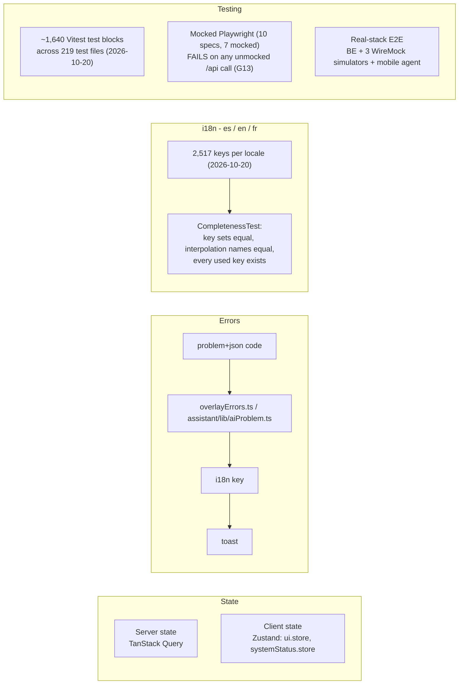

# State, errors, i18n, tests

Status: Current-verified (code, 2026-10-03; spot-checked 2026-10-20) | Owner: TBD

There is no Redux and no global store of server data. An `AiProposal` is server state with a lifecycle,
so it belongs in a query with an invalidation key, never in component state — confirmed in practice by
`assistant`'s own hooks (see
[04-assistant-feature.md](04-assistant-feature.md)).

Numbers above are counted directly (2026-10-03) rather than carried forward from an earlier, stale
snapshot: i18n keys counted by flattening `src/i18n/locales/en.json` leaves, matching exactly what
`CompletenessTest.test.ts` flattens; test-block count is a static grep over `it(`/`test(` across
`src/**/*.test.{ts,tsx}` (approximate — not an executed run count, and `it.each` table headers can
inflate it slightly). Regenerate before quoting externally.

## Console contracts (reDesignFE)

Enforced by a guard — breaking one fails `npm run test:run`, not review:

- **PageHeader contract.** A page never renders its own `<h1>`. It calls `<PageHeader title=... />`,
  which writes into the shell through `PageHeaderProvider`; the shell renders the single `h1` on the
  document. Inside a page, headings use `<SectionHeading level={2|3}>`, never a raw `h2`-`h6`. Guard:
  `src/__tests__/repo/accessibility.test.ts`.
- **Design tokens contract.** Colour values live only in `src/shared/design/tokens.ts`; `tailwind.config.ts`
  and the chart theme read from it. No hex, no raw Tailwind palette hue and no off-scale size anywhere
  else in `src`. Status tones carry both a colour and a mark, so two statuses never look identical in
  greyscale. Guard: `src/__tests__/repo/designSystem.test.ts`.

| Guard | What it holds |
|---|---|
| `src/__tests__/repo/accessibility.test.ts` | landmarks and the skip-link target, the single `h1`, heading level vs. size, no page-level spinner |
| `src/__tests__/repo/designSystem.test.ts` | tokens, the type scale, focus-visible, reduced motion, status tone plus mark |
| `src/__tests__/repo/keyboardOperability.test.ts` | every drag-and-drop surface has a keyboard sensor and a non-drag control (relevant to `MacroEditorModal.tsx`, which uses `@dnd-kit`) |
| `e2e/specs/axe.spec.ts` | axe-core on the primary routes, at both window classes |
| `e2e/specs/reflow.spec.ts` | 320/768/1024/1440 px reflow; below 840 px the rail becomes a drawer, not nothing |

Several of these guards assert they found something to check, so a guard cannot pass by matching no
files. The `assistant` feature already complies with the PageHeader/`SectionHeading` contract — its
panels use `<SectionHeading level={3}>` consistently.
