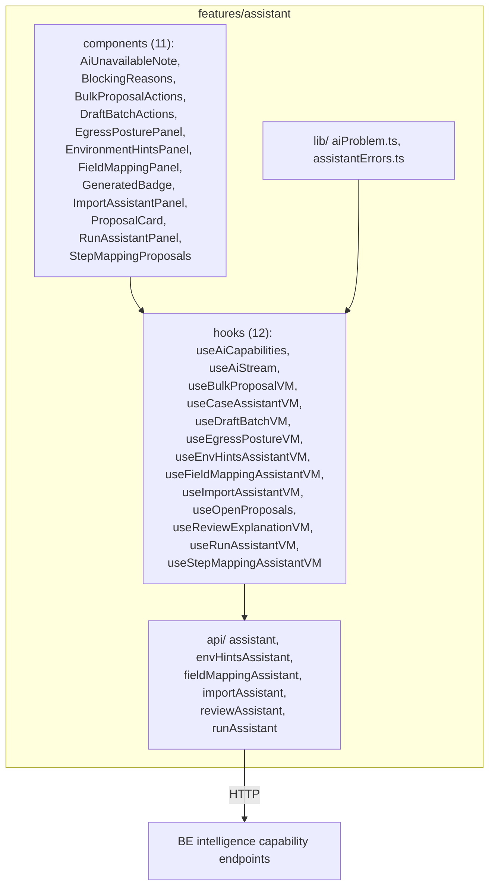

# The assistant feature

Status: **implemented, current code** — 34 files, 2,720 LOC under `src/features/assistant/`. This
replaces the former "Where AI touches the frontend (proposed)" section, which named a speculative API
(`ProposalCard`/`useAiProposals`/`useAiBudget`) that only partially matches reality: `ProposalCard`
exists, but the rest of that sketch does not. No `pages/` directory exists — `assistant` is never a
routed screen, only embedded UI, consumed by five screens (see
[01-rings-and-modules.md](01-rings-and-modules.md)).

## The data model

`AiProposal` is the central server-state shape: `{ id, capability, kind, subjectType, subjectId,
baseVersion, payload, confidence?, rationale?, questions, status, createdBy, createdAt, decidedBy?,
decidedAt?, expiresAt, rowVersion }`. `baseVersion` is the subject's own row version when the capability
ran; `rowVersion` is the proposal's own, used for optimistic-concurrency decisions.
`AiProposalStatus` lifecycle: `PROPOSED -> {ACCEPTED, ACCEPTED_WITH_EDITS, REJECTED, SUPERSEDED,
EXPIRED}` — exactly one transition out of `PROPOSED`, every outcome terminal; a reviewer who changes
their mind asks again rather than reopening the old proposal. `AiProposalKind` matches the backend's
`ProposalKind` exactly: `NONE, CANONICAL_DRAFT, STEP_MAPPING, ENVIRONMENT_HINTS, MACRO,
CONNECTOR_FIELD_MAPPING`.

`AiCapability` is the per-capability descriptor the console reads once per project:
`{ id, enabled, available, unavailableReason, fallback, tier, proposalKind, streamable }`. `enabled`
(deployment switch) and `available` (could run right now — mapped, within egress posture, within budget)
are different questions, and every affordance in the UI is gated on `available`, never `enabled`.
`AiUnavailableReason`: `DISABLED, PROJECT_DISABLED, NOT_MAPPED, EGRESS_REFUSED, PROVIDER_UNAVAILABLE,
BUDGET_EXCEEDED`.

## Proposals as server state, with a lifecycle

`useAiCapabilities(projectId)` is a single shared TanStack Query (`staleTime: 60s`) every screen offering
an AI affordance reads from — once, not per-screen 503-probing. It exposes safe selectors
(`isAvailable`, `reasonOf`, `fallbackOf`, `isStreamable`) that default to the unavailable/empty case while
loading or on failure — never a false-positive enabled button.

`useOpenProposals(projectId, caseId)` is the single shared per-case query that both `useCaseAssistantVM`
(`testcase.normalize`) and `useStepMappingAssistantVM` (`step.map.propose`) read from, each filtering by
its own capability id — one query, not two, since two capabilities may propose about the same case and
each assistant should act only on the ones its own capability produced.

Lifecycle in the UI: **propose** (a mutation) records the proposal server-side and explicitly changes
nothing about the case. **accept** (optionally with an edited payload) is the human decision — the only
call that mutates the subject; **reject** leaves the subject untouched, the refusal itself is the record.
Both are conditional via `baseVersion`/`rowVersion`: `useCaseAssistantVM` computes
`stale = open.baseVersion !== testCase.rowVersion` and disables Accept when stale, surfaced by
`ProposalCard` as a stale hint.

Two higher-volume paths exist beside the single-case flow: `useBulkProposalVM` (a loop of per-case
conditional accepts over the project-wide open-proposal list, continuing past individual failures —
deliberately not a new batch endpoint, since each accept must stay independently conditional on its own
row version) and `useDraftBatchVM` (queues an asynchronous provider batch job, polled every 15s while
`AWAITING_PROVIDER`/`COLLECTING`; nothing is auto-applied when the job finishes — each item becomes an
ordinary per-case `PROPOSED` proposal that still needs a human decision, exactly like the synchronous
path).

## How an AI-generated result is visually distinguished from deterministic output

One shared component, `GeneratedBadge`, not a convention each screen has to remember separately — "a
reader of the code can find it, and a test can assert it." It renders beside the heading of every
assistant-produced panel: `ImportAssistantPanel`, `RunAssistantPanel` (summary and, with an "advisory"
caption, triage), `ProposalCard`, `EnvironmentHintsPanel` (only on AI-origin hints — deterministic hints
get a plain "found by platform" badge with a lock icon instead), `FieldMappingPanel` (same lock-icon
treatment for the confirmed mapping), `BulkProposalActions`, `DraftBatchActions`.

Secondary devices, all confirmed in component source: a trailing one-line human-decides disclaimer on
nearly every panel; confidence rendered as a bare number that nothing in the product branches on;
streaming text (see below) shown in a visually distinct, muted style — "progress, never the answer," since
the validated response, not the accumulated stream, is what gets stored; `AiUnavailableNote` always
renders in an info tone, never a status-tone colour, because "AI is off" is not a verdict about a test.

## Realtime streaming

`useAiStream` opens a STOMP subscription to `/topic/projects/{projectId}/ai/{streamId}`, where
`streamId` is minted client-side and sent with the request **before** the request is issued — an id the
response carried would arrive after the work it describes. It only accumulates delta text into a
`partial` state; the validated answer always arrives in the HTTP response the caller already awaits.
Used today only by `useRunAssistantVM`'s summarize mutation.

## Per-capability hooks

| Hook | Capability | Notes |
|---|---|---|
| `useAiCapabilities` | — | shared capability/availability read |
| `useAiStream` | — | STOMP streaming progress |
| `useOpenProposals` | — | shared per-case proposal query |
| `useCaseAssistantVM` | `testcase.normalize` | draft propose/accept/reject for one case |
| `useStepMappingAssistantVM` | `step.map.propose` | proposes only for steps with no catalog step id; accept never touches an already-mapped step |
| `useImportAssistantVM` | `import.duplicates.detect` | on-demand batch review, max 50 cases per call, dropped when the page's case-id set changes |
| `useEnvHintsAssistantVM` | `env.hints.extract` | proposed hints whose key already exists in stored config are filtered out before display — "augmented, never replaced" |
| `useFieldMappingAssistantVM` | `connector.fieldmap.propose` | confirm-once-per-integration; a reviewer can drop proposed roles before confirming; a zero-mapping result is a valid terminal state |
| `useReviewExplanationVM` | `review.explain` | on-demand only, never on selection, to avoid spending budget on browsing; matched to deterministic blocking reasons by sentence text |
| `useRunAssistantVM` | `report.summarize`, `failure.triage` | summary stored as an execution artifact (read-before-offering); triage is advisory-only, not stored |
| `useBulkProposalVM` / `useDraftBatchVM` | — | bulk/batch accept paths, above |
| `useEgressPostureVM` | — | project-level egress posture setting; a project-owner decision, not an admin privilege — the company that created the project is the only party entitled to say whether its test cases may be sent to a third party |

## Error handling

Two typed-refusal mechanisms live in `assistant/lib/`: `aiProblem.ts` keys on the backend's stable `code`
field first (`AI_DISABLED, AI_UNAVAILABLE, AI_EGRESS_REFUSED, AI_PROVIDER_FAILED, AI_OUTPUT_INVALID,
AI_DRAFT_INVALID, AI_SUMMARY_EMPTY, AI_BUDGET_EXCEEDED, AI_RATE_LIMITED, AI_PROPOSAL_STALE`), falling
back to a `type`-keyed table only when `code` is absent — `AI_BUDGET_EXCEEDED` and `AI_RATE_LIMITED`
share the same wire `type` but need different messages, which only `code` can distinguish.
`assistantErrors.ts`'s `assistantErrorKey` is a thin forwarding wrapper kept because `useOpenProposals`
call sites already reference that name.

## Cross-feature touchpoints

`overlay` (heaviest consumer), `project` (`ProjectIntegrationsPage`), `execution`
(`ExecutionResultsPage`), `scenario` (`FeatureDetailPage`), `catalog` (`MacroEditorModal`, hook only — no
panel; it also uses a `macro.draft` capability id that is absent from the FE `AI_CAPABILITY` const map, a
minor incompleteness in that map, not a bug). `assistant` itself imports only `overlay/types.ts`.

## Tests and open gaps

14 test files under `src/__tests__/features/assistant/`: 6 component tests, 7 hook tests, 1 lib test. No
dedicated standalone test files were found for `ProposalCard`, `StepMappingProposals`, `GeneratedBadge`,
`AiUnavailableNote`, `BulkProposalActions`, `DraftBatchActions`, `useOpenProposals`,
`useEnvHintsAssistantVM`, `useFieldMappingAssistantVM`, `useEgressPostureVM`, `useImportAssistantVM`,
`useReviewExplanationVM` — they may be covered indirectly through host-screen tests, but coverage depth
was not traced; this is an open question, not a confirmed hole.
