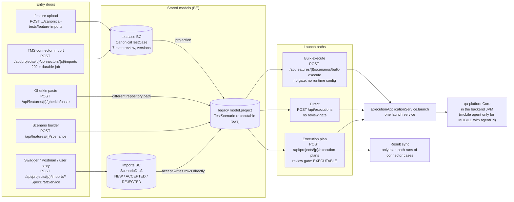
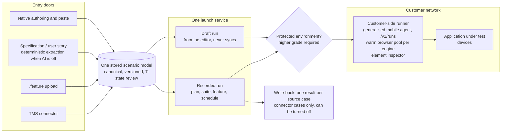

# Entry doors, launch paths and the target runtime

Status: Current-verified (code, 2026-10-20) for "Today"; Intended (from [alcance.md](../../alcance.md)) for
"Target" | Owner: TBD

A·Spectra is one execution runtime with one stored scenario model, reached through several entry doors
(alcance §1.2). This page is the map that ties the code to that decision: what exists today, where it
diverges from the decided scope, and the target shape. Requirement IDs refer to
[requirements.md](../../requirements.md).

## Today: five doors, two stored models, three launch paths

What the diagram shows, and where it diverges from the decided scope:

| Today | Decision | Requirement |
|---|---|---|
| Spec and story drafts live in their own model and write executable rows on accept | The pipeline terminates in the canonical model | IMB-01, IMB-02 |
| Gherkin paste uses a different repository path than the scenario builder | Paste goes through the one stored model | AUT-03 |
| Only the plan path has a review gate | Correct: review is a console convention, not a backend invariant; the gate stays on the plan path only | EXE-01, REV-06 |
| Bulk execute carries no layer, Web, reporting or HTTP-engine configuration | Bulk execute carries the full runtime configuration | EXE-03 |
| Only plan-path runs of connector cases sync, and skips are silent | Recorded runs (plan, suite, feature) of connector cases sync; every skip is reported before the run | SYN-03, SYN-08 |
| Every run except a mobile run with an agent executes in the backend JVM | Execution moves out of process onto the customer-side runner | EXE-02 |

## Target: one model, one launch service, the customer-side runner

The runner is one piece of infrastructure answering four commitments at once: private-network
execution, the element inspector, run durability across deploys, and the warm browser pool (alcance §3,
§9.1). Requirements: ORG-18, EXE-02, WEB-06, NFR-01, NFR-03, NFR-05, ENV-05, SYN-01, SYN-09.
