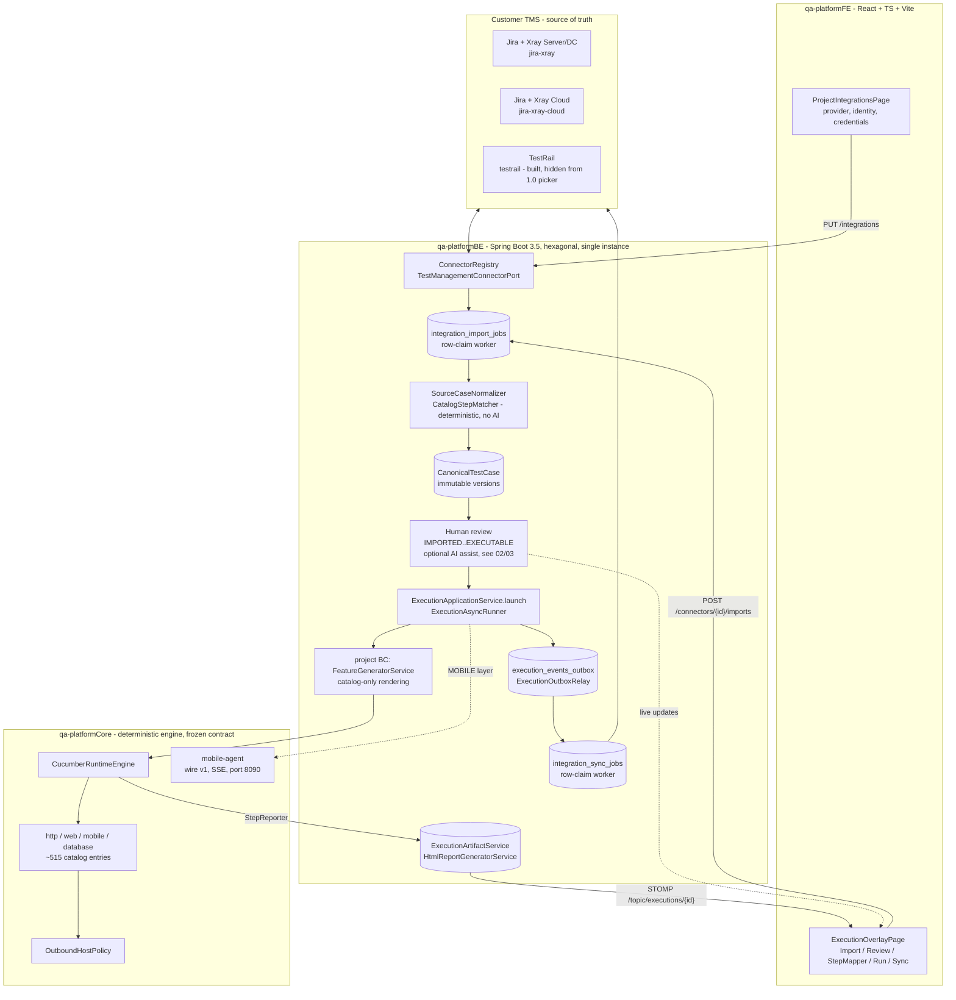
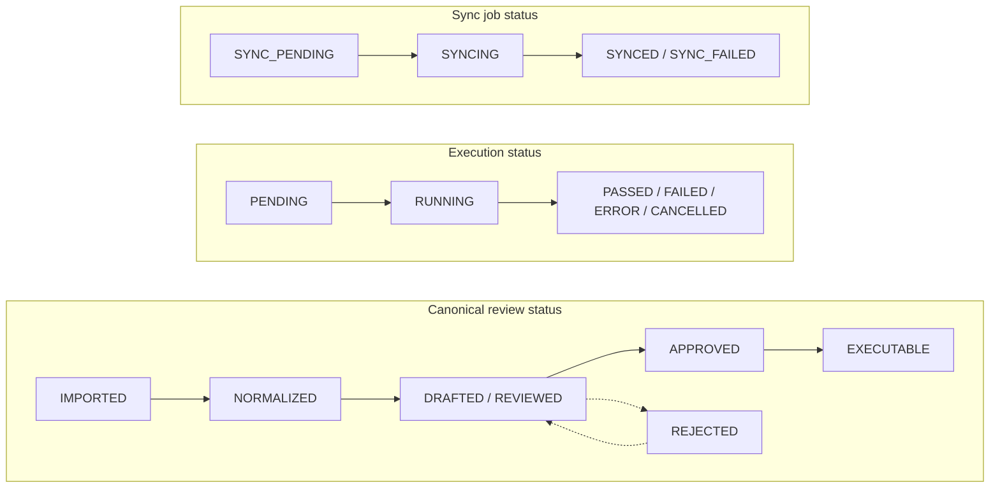

# The overlay loop

Scope: the whole solution, current state. The customer's test management system (TMS) stays the
source of truth. The platform imports selected cases, normalizes them, requires human approval,
executes deterministically, stores evidence, and writes results back into the container the cases
came from.

Note: `FeatureGeneratorService` renders Gherkin text from catalog step patterns only (never from AI)
and is owned by the `project` bounded context, not `execution` — `ExecutionAsyncRunner` calls across
that BC boundary through its published service, not an ACL re-implementation, since both live in the
same backend.

TestRail's connector (`TestRailConnectorAdapter`) and FE descriptor are fully built and auto-discovered
by `ConnectorRegistry` exactly like Jira/Xray. It is withheld from the project-creation picker by a
single FE allowlist (`OFFERED_CONNECTOR_PROVIDERS` in `connectorProviders.ts`) pending its own validated
release (ticket TR4) — a product gate, not a missing implementation. A project already configured with
it keeps working.

## Stage ownership

| Stage | Entry point | Owner |
|---|---|---|
| 1 Connect | `PUT /api/projects/{id}/integrations`, `POST .../integrations/detect` | `project` BC + connector adapters |
| 2 Import | `POST /api/projects/{p}/connectors/{c}/imports` (202 + job row) | `ConnectorImportApplicationService` |
| 3 Canonical + review | `CanonicalTestCaseApplicationService` | `testcase` BC |
| 4 Plan + projection | `ExecutionPlanApplicationService` | `testcase` -> legacy `TestScenario` |
| 5 Run | `ExecutionApplicationService.launch` | `execution` BC |
| 6 Evidence | `BEStepReporter`, `ExecutionArtifactService` | `execution` BC |
| 7 Sync | outbox -> `IntegrationSyncJobApplicationService` | `testcase` BC |
| 8 Console | `ExecutionOverlayPage` | FE `features/overlay` |

Stage 4 has no FE screen of its own, by design: it is folded into the environment-and-runtime-config
step every "Run"/"Execute" action collects immediately before launch (confirmed 2026-10-01, see
workspace `.claude/CLAUDE.md`).

## How each stage hands off to the next

**Stage 1 -> 2 (Connect -> Import): synchronous, no job.** `PUT /api/projects/{id}/integrations`
writes credentials; `ConnectorRegistry.configured(projectId)` resolves the project's one connector by
provider type directly — no job row.

**Stage 2 (Import): a durable job, claimed by a scheduled poller, never by the request.**
`ConnectorController.startImport` calls `ConnectorImportApplicationService.startImport`, which inserts
a job row `QUEUED` and returns 202 immediately. `ImportJobWorkerAdapter`
(`@Scheduled(fixedDelayString = "${integration.import.worker-delay-ms}")`) claims due jobs, reads
source cases in batches of 50 outside any transaction, and imports each item in its own transaction so
one failing item never rolls back the others. The job ends `COMPLETED`, `PARTIAL` or `FAILED`; a
rate-limited provider re-queues with backoff.

**Stage 2 -> 3 (Import -> Canonical + review): one normalization call per case, deterministic by
default.** `SourceCaseNormalizer` computes a SHA-256 hash over canonicalized source fields only
(excluding mapping results and flags, so a better mapper never creates a spurious new version), infers
the execution layer, and calls `CatalogStepMatcher` — the one deterministic step mapper, no fuzzy
matching, no AI. Exactly one match maps a step; zero or several leave it unmapped.

**Stage 3 (Canonical + review): optional, human-triggered AI assist runs beside the deterministic path,
never instead of it.** `TestCaseAiNormalizationService` (`testcase.normalize`) and
`TestCaseAiStepMappingService` (`step.map.propose`, only for positions the deterministic matcher left
unmapped) are synchronous propose/accept calls gated by project write access and by `baseVersion` vs.
the case's current `rowVersion`. See [02-critical-flows.md](02-critical-flows.md) flow (e) for the full
pipeline.

**Stage 3 -> 4 -> 5 (Review -> Plan -> Run): a synchronous launch request that returns before execution
finishes.** `ExecutionApplicationService.launch` validates, inserts an `Execution` row `PENDING` inside
one transaction, claims ownership (instance-id + timestamp — the two-instance row-claim pattern), and
only on `afterCommit()` submits the run to `ExecutionAsyncRunner`. The HTTP response returns once the
`PENDING` row is durable; the Cucumber run happens asynchronously after commit.

**Stage 5: transport selection is a routing decision, not a BC boundary.**
`ExecutionTransportSelector` picks `HttpAgentTransport` only when `layer=mobile` and the environment has
a non-blank `agentUrl`; every other case gets `InProcessTransport` (same JVM). The agent URL is checked
against `OutboundUrlPolicy` before the transport object is built — never a silent fallback to in-process,
which has no device.

**Stage 5 -> 6, mobile path: wire v1 over HTTP/SSE.** `POST /v1/runs` on the mobile-agent submits
`featureContents` and returns 202 with a run id; `GET /v1/runs/{id}/events` is a long-lived SSE stream
forwarding typed events (`STEP_ATTACHMENT` included). A client disconnect never kills the run — a
reconnect takes over via a subscriber-generation counter, and an undelivered terminal event is
requeued, not dropped.

**Stage 6 -> 7 (Evidence -> Sync): outbox, then a second, independent durable job.** On a terminal
execution state, an `execution_events_outbox` row is written in the same transaction as the state
change (the single publication path). `ExecutionOutboxRelay` is the only publisher of
`ExecutionFinishedEvent`; `IntegrationSyncJobEventAdapter` creates a sync job when `sync_mode=AUTO` (or
a human triggers one manually). The sync job is its own row-claim worker with its own backoff, fully
independent of the import job's lease. A provider failure here never touches the execution's own
terminal result.

## Three independent state machines

Never folded into one another (workspace `.claude/CLAUDE.md` working rule 4).

`ExecutionStatus` also has a `SKIPPED` value, scenario/step-level only — an execution itself never ends
`SKIPPED`.
