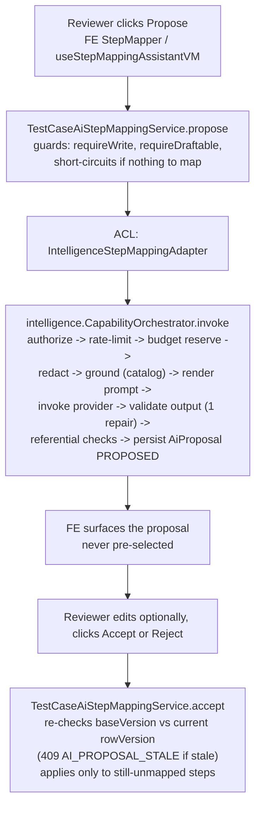
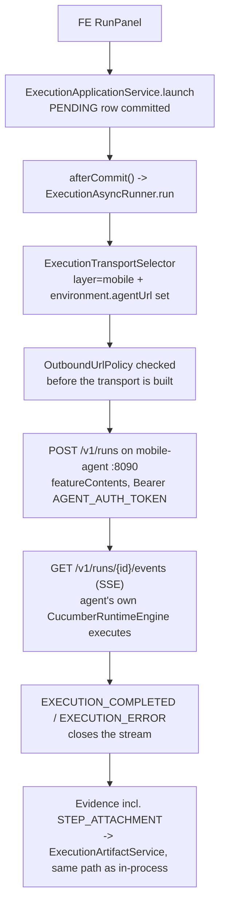

# Critical flows

One grounded flow per import source, plus the AI-assisted review path and a mobile execution run.
Each lists the real hop chain, what is durable versus synchronous, and where the human approval gate
sits.

## (a) Jira + Xray import (Server/DC and Cloud) -> canonical review

```mermaid
flowchart LR
    FE1["FE ProjectIntegrationsPage<br/>PUT /integrations"] --> FE2["FE ImportPanel<br/>POST /connectors/{c}/imports"]
    FE2 --> CC["ConnectorController.startImport"]
    CC --> CIAS["ConnectorImportApplicationService<br/>insert job row QUEUED, return 202"]
    CIAS -. "durable, leased PT15M" .-> IJW["ImportJobWorkerAdapter - scheduled poller"]
    IJW --> CA["JiraXrayServerConnectorAdapter /<br/>XrayCloudConnectorAdapter<br/>(resolved by ConnectorRegistry)"]
    CA --> SCN["SourceCaseNormalizer + CatalogStepMatcher<br/>per-item transaction, deterministic"]
    SCN --> REVIEW["FE ReviewQueue / CaseDetail / StepMapper<br/>HUMAN GATE"]
    REVIEW --> APPROVE["APPROVED -> EXECUTABLE"]
```

Durable: the import job row (lease PT15M). Synchronous: the normalization call inside the worker's
per-item transaction; the review/approve HTTP calls. Server/DC vs. Cloud is purely which connector
adapter is registered to the project — everything downstream of "cases arrived" is identical.

## (b) Postman collection import

```mermaid
flowchart LR
    FE["FE ImportsPage<br/>POST /imports/postman (multipart)"] --> IC["ImportsController.uploadPostman"]
    IC --> IAS["ImportApplicationService.importFile<br/>ImportSource.POSTMAN, @Transactional"]
    IAS --> VAL["FileValidationService +<br/>PostmanSpecValidator"]
    VAL --> PARSE["PostmanParserAdapter.parse<br/>-> ParsedImport"]
    PARSE --> HANDLE["ImportAndSuggestHandler"]
    HANDLE --> DRAFT["SpecDraftService.draft<br/>one AI call per endpoint, not a batch<br/>outside the DB transaction (G4)"]
    DRAFT --> SD[("ScenarioDraft rows, status NEW")]
    SD --> FE2["FE ScenarioSuggestionsPage /<br/>ScenarioDraftBuilderPage<br/>HUMAN GATE"]
    FE2 --> ACC["accept -> TestScenario created /<br/>reject"]
```

Durable: none — the whole import is one synchronous request/response
(`@Transactional` on `importFile`), unlike the connector import. The AI draft call happens inside that
same request but outside the transaction (reaches a provider, G4). Deterministic fallback: if AI is
unavailable, every endpoint still becomes a `ScenarioDraft` — unmapped, zero confidence, nothing
invented. Human gate: draft accept/reject.

## (c) Swagger/OpenAPI import

Identical pipeline to (b): `POST /imports/swagger` -> `ImportsController.uploadSwagger` -> the same
`ImportApplicationService.importFile(..., ImportSource.SWAGGER, ...)` -> `SwaggerSpecValidator` +
`SwaggerParserAdapter` in place of the Postman pair -> the same `ImportAndSuggestHandler` /
`SpecDraftService` -> the same draft accept/reject gate. `ImportAndSuggestHandler` constructor-injects a
`Map<ImportSource, SpecParsingPort>` and a `Map<ImportSource, SpecValidatorPort>` — one handler,
pluggable parser/validator pair per source, not a duplicated pipeline per format.

## (d) User-story import

Two entry points converge on the same downstream pipeline: `POST /imports/user-story/file` (file
upload) or `POST /imports/user-story` (JSON body of title + acceptance criteria — `ImportsController`
synthesizes a `Feature:`/`Scenario:` Gherkin string server-side from the request fields). Both reach
`UserStorySpecValidator` + `UserStoryParserAdapter`, then the same `ImportAndSuggestHandler` /
`SpecDraftService` / accept-reject gate as (b)/(c). Same durability profile: synchronous request, no
job.

## (e) AI-assisted path during review (non-authoritative, human-approved)

Step-mapping proposal during canonical review — the most completely verified example of the
propose/accept shape every AI-assisted path in the product follows:

Durable: only the `AiProposal` row itself; the call is synchronous request/response, not a job. Human
gate: the separate `accept()`/`reject()` call — the model's answer alone never reaches domain state.
The deterministic matcher's own mappings are never overwritten, whatever the proposal says. See
[../architectureBE/05-intelligence-bounded-context.md](../architectureBE/05-intelligence-bounded-context.md)
for the full pipeline internals.

## (f) Mobile execution run through the mobile-agent

Durable vs. in-process: the `Execution` row and its ownership claim are durable (instance-id claim,
two-instance safe); the wire call itself is a long-lived HTTP/SSE session, not a row-claimed job — a
backend restart mid-run loses the SSE subscription (a documented, accepted limitation; making this
lossless is a separate, not-yet-scheduled decision). Human gate: none mid-run — deterministic execution
needs no approval; the human gate for this layer sits earlier, at canonical review/approval, same as
every other layer.
