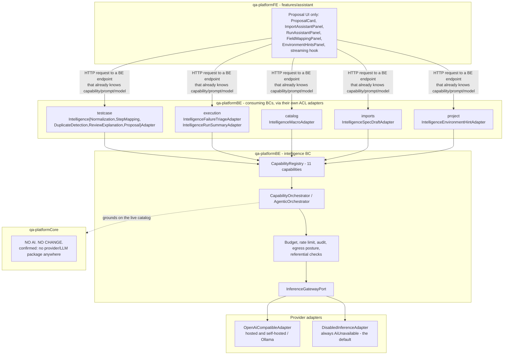

# The intelligence capability — macro view

Status: Current-verified (code, 2026-10-03; spot-checked 2026-10-20) | Owner: TBD

The `intelligence` capability is **implemented, current code** — governed and off by default
(`AI_ENABLED=false`), never "proposed." This is the general-reader placement across the three
repositories; the deep internals (pipeline, governance, provider adapters, job design) live in
[../architectureBE/05-intelligence-bounded-context.md](../architectureBE/05-intelligence-bounded-context.md).

## Where it sits, by repository

- **FE** holds proposal UI only. No provider key, no prompt text, no model call ever originates in the
  browser — every assist action is a request to a BE endpoint that already knows which capability,
  prompt and model apply. Proposals are server state fetched through TanStack Query hooks, never a
  client-side computation.
- **Core** has zero AI code — confirmed by package scan, no provider-named package anywhere in any
  module. The only Core-adjacent AI-era work is regenerating i18n step-description resources, never
  executable code.
- **BE** owns everything: the capability registry, the orchestration pipeline, every provider adapter
  (`DisabledInferenceAdapter` is the always-on default when AI is off; `OpenAiCompatibleAdapter` for a
  real provider — there is no Anthropic adapter today), prompt versioning, budget/rate-limit/audit
  infrastructure, and the authenticated STOMP streaming channel. Every consuming BC reaches
  `intelligence` only through its own ACL adapter package — the same "cross-BC through infrastructure
  ACL only" rule that governs every other BC boundary in this backend.

## Governance posture

- **Disabled by default.** `ai.enabled=false` is the deployment default, with the explicit design
  intent "AI is opt-in for a deployment, never on because nobody turned it off." A per-capability kill
  switch also exists.
- **Fail-closed.** When disabled or unavailable, every consuming service either returns a typed
  `AI_UNAVAILABLE`/`AI_DISABLED` refusal or falls back to a declared deterministic path (an import still
  produces reviewable drafts with nothing invented) — never a silent success.
- **Human approval required before any domain-state change.** Every capability that could affect a
  canonical case follows the same two-call shape: a `propose()` that writes only an `AiProposal` row,
  and a separate `accept()`/`confirm()` that is the only call that mutates the case, gated by
  `baseVersion` against the subject's current row version.
- **Referential grounding.** A dedicated check runner rejects any model answer that names a step id,
  outbound host, or source mutation the rest of the system doesn't recognize as valid — a capability
  cannot name a step that does not exist in the live catalog.
- **Per-project governance is real, not theoretical.** A project-level egress posture
  (`HOSTED_ALLOWED` / `SELF_HOSTED_ONLY` / `AI_DISABLED`) is project-write-settable and enforced before
  routing to a provider, never model-inferred.

11 capabilities are registered today (`testcase.normalize`, `step.map.propose`, `review.explain`,
`report.summarize`, `env.hints.extract`, `import.duplicates.detect`, `macro.draft`, `macro.name`,
`spec.scenarios.draft`, `failure.triage`, `connector.fieldmap.propose`); none currently runs at a `DEEP`
tier. See the BE folder for the per-capability tier/grounding/check table.

## Scope decided for these capabilities

From [alcance.md](../../alcance.md) §8 (requirements AI-01..AI-09): AI stays off by default permanently and
every capability keeps its deterministic fallback. Nine capabilities are in scope; `failure.triage` and
`connector.fieldmap.propose` are experiment-only, opt-in and advisory, and are not sold until each passes
its own evaluation (G31). The per-project egress posture shown above is decided to become an organisation
setting changed only by the organisation administrator (ORG-12). Generation from specifications is shown
only where AI is enabled; with AI off, Swagger/OpenAPI and Postman imports use deterministic extraction
(IMB-03, IMB-04).
